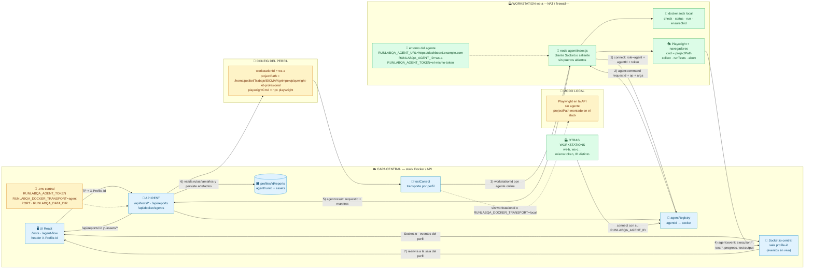
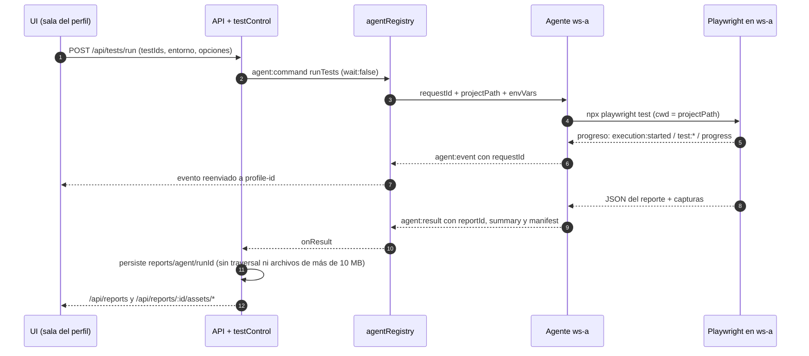

# RunLab Agrimpex — UI

Frontend del dashboard QA **RunLab Agrimpex** para gestionar perfiles, configurar proyectos de automatización, explorar/ejecutar tests Playwright y consultar resultados/evidencias.

- **Stack:** React 19 + TypeScript + Vite + TanStack Router/Query/Table + shadcn/ui + Tailwind CSS 4.
- **Backend hermano:** `runlab-agrimpex-api` (Express + Socket.io), que expone la API REST, emite eventos en tiempo real y sirve el build en producción.
- **Línea base:** esqueleto UI de `DAM.Frontend.React` (plantilla [shadcn-admin](https://github.com/satnaing/shadcn-admin), MIT © Sat Naing; adaptaciones © potlitel).

## Índice

- [Arquitectura](#arquitectura)
- [Arquitectura distribuida del módulo Docker](#arquitectura-distribuida-del-módulo-docker)
- [Requisitos](#requisitos)
- [Ejecución manual](#ejecución-manual)
- [Ejecución con Docker](#ejecución-con-docker)
- [Ventaja de la imagen Playwright](#ventaja-de-la-imagen-playwright)
- [Vistas principales](#vistas-principales)
- [Perfiles y avatares](#perfiles-y-avatares)
- [Configuración del proyecto y `playwrightCmd`](#configuración-del-proyecto-y-playwrightcmd)
- [Evidencia gráfica: defaults, nombres y rollback](#evidencia-gráfica-defaults-nombres-y-rollback)
- [Estado del backend y badge de salud](#estado-del-backend-y-badge-de-salud)
- [Vista de salud](#vista-de-salud)

## Arquitectura

```text
runlab-agrimpex-ui (React, dev :5173 / dist en prod)
        │  HTTP /api  +  Socket.io (/socket.io)
        ▼
runlab-agrimpex-api (Express + Socket.io, :3001)
        │
        ├─ Perfiles/workspaces en disco (profiles/<id>/...)
        ├─ Colección y ejecución Playwright sobre projectPath
        └─ Reportes, entornos, Docker, schedules, datos y evidencia
                │
                ▼
      Proyecto de automatización Playwright (AUT / suite)
```

- En desarrollo, Vite hace proxy de `/api` y `/socket.io` hacia `http://localhost:3001`.
- En producción, el backend sirve el `dist` del frontend.
- La sesión de trabajo opera por **perfil activo** (sin autenticación en esta etapa): la UI envía `X-Profile-Id` y se suscribe a la sala Socket.io `profile:<id>`.
- El módulo Docker **no se ejecuta en el servidor central**: se ejecuta en la workstation asignada al perfil, mediante un agente. Ver [Arquitectura distribuida del módulo Docker](#arquitectura-distribuida-del-módulo-docker).

## Arquitectura distribuida del módulo Docker

La UI está centralizada, pero el Docker que inspecciona el panel es **el de la workstation del perfil**, no el del servidor donde corre la API. El socket del daemon nunca sale de la workstation.

```text
Workstation A ── agente (WebSocket saliente + token) ──┐
Workstation B ── agente ───────────────────────────────┼── API central ── Socket.io ── UI
Workstation C ── agente ───────────────────────────────┘
```

El agente ejecuta `check / status / containers / run / stop / start / ensureGrid / collect / runTests / abort` localmente y streams los logs por el mismo canal. La API deja de spawnear `docker` y solo enruta por `agentId/profileId` (también en las calendarizaciones con Docker). El perfil pasa a tener un `workstationId` en vez de un `projectPath` que hoy solo existe en el host donde corre la API. Así la frase queda literal: **UI centralizada, Docker de cada workstation, socket nunca sale de la workstation**.

> [!IMPORTANT]
> ### ¿Quién es el agente?
>
> **No es un servicio web.** No abre puerto, no escucha HTTP, no está en `docker compose` y nadie le habla directamente. Es un **proceso Node de larga duración** — un worker/CLI — que corre en cada workstation con `node agent/index.js`.
>
> Lo que hace es:
>
> 1. Al arrancar, **marca hacia fuera** por Socket.io a `RUNLABQA_AGENT_URL` y se autentica con `agentId` + token.
> 2. Se registra en el `agentRegistry` de la API y se queda esperando `agent:command`.
> 3. Ejecuta la orden **localmente** reutilizando `services/dockerRunner.js` (el mismo código que antes usaba la API) — ahí es donde se spawnea `docker` / `docker compose`.
> 4. Devuelve `agent:result` y va emitiendo `agent:event` con los logs, que la API reenvía a la sala `profile:<id>`.
>
> |                | Agente                                    | API central                        |
> | -------------- | ----------------------------------------- | ---------------------------------- |
> | Rol            | la «mano» en la workstation               | enrutador, registro, persistencia  |
> | Red            | conexión saliente, sin puertos abiertos   | escucha HTTP + Socket.io           |
> | Estado         | stateless, solo `requestId`               | registry + perfiles + reportes     |
> | Arranque       | systemd / NSSM / supervisor               | contenedor del stack               |
>
> Se le dice «servicio» porque conviene registrarlo como servicio del SO para que arranque solo, pero **arquitectónicamente es un cliente, no un servidor**. Eso es justo lo que permite tener workstations detrás de NAT/firewall y sin IP pública: solo la API necesita ser alcanzable. Socket.io reconecta sola ante cortes; el supervisor del SO se encarga si el proceso muere.

> [!NOTE]
> ### Diseño: token global, ID por workstation, `workstationId` por perfil
>
> **El token es global** (uno compartido por la API y todos los agentes): solo responde a la pregunta «¿está autorizado este agente?».
>
> **`RUNLABQA_AGENT_ID` identifica la workstation** (un valor por máquina: `ws-a`, `ws-b`, `ws-c`).
>
> **`workstationId` es por perfil**: es el puntero que dice «este perfil usa esa workstation».
>
> Por eso varios perfiles pueden convivir en la misma UI/API central apuntando a workstations distintas con un único token, y por eso el transporte tiene que acabar siendo una decisión por perfil y no un interruptor global: un perfil con `workstationId` va al agente, y un perfil sin él puede seguir usando su `projectPath` local en el servidor (el caso híbrido previsto).
>
> La consecuencia operativa es que, si algún día cambias una workstation de agente (p. ej. `ws-a` → `ws-a-nuevo`), solo editas ese campo en **Ajustes > Proyecto** de los perfiles afectados; no hay que tocar el token ni redesplegar la API.

### Contrato agente ↔ API

| Elemento | Contrato |
|---|---|
| Registro | Conexión Socket.io **saliente** del agente con `auth: { role: 'agent', agentId, token }`; se une a la sala `agent:<agentId>`. |
| Comando | `agent:command` con `{ requestId, op, profile, args }`, donde `profile` incluye `id` y el `projectPath` de la workstation, y `args` los parámetros (p. ej. `{ action: 'up-build' }`). |
| Progreso | `agent:event` con `{ requestId, event, payload }`; la API lo reemite al room `profile:<id>` como `docker:started`, `docker:log`, `docker:exit` y `profiles:status`. La UI no cambia de eventos. |
| Resultado | `agent:result` con `{ requestId, ok, data, error }`. Resuelve la petición REST que espera respuesta; timeout de 15 s. |
| Operaciones | `check`, `status`, `containers`, `run` (whitelist de acciones de compose), `stop`, `start`, `report` y `ensureGrid` (usado por el scheduler). |
| Agentes conectados | `GET /api/docker/agents` devuelve `{ agents: [{ agentId, label, connectedAt }] }`. |

### Configuración

| Variable / campo | Dónde | Efecto |
|---|---|---|
| `workstationId` | `profiles/<id>/config.json` (Ajustes > Proyecto > ID del agente Docker) | Agente que atiende el perfil. Sin él, `/api/docker/*` responde `400`. |
| `projectPath` | `profiles/<id>/config.json` | Ruta **dentro de la workstation**, usada como `cwd` por el agente. |
| `RUNLABQA_AGENT_TOKEN` | entorno de la API y del agente | Token compartido; sin él la API rechaza conexiones de agentes (fail closed). |
| `RUNLABQA_AGENT_URL` | entorno del agente | URL pública de la API central (`https://…`). |
| `RUNLABQA_AGENT_ID` | entorno del agente | Identificador que debe coincidir con `workstationId`. |
| `RUNLABQA_AGENT_LABEL` | entorno del agente | Etiqueta legible para `/api/docker/agents`. |
| `RUNLABQA_DOCKER_TRANSPORT` | entorno de la API | `agent` (default) o `local` (modo legado: la API ejecuta `docker` en su propio host, solo para desarrollo). |
| `NODE_USE_ENV_PROXY` | entorno del agente | Si está activo, el agente se relanza sin él para que Socket.io no pase por el proxy corporativo; `HTTP_PROXY`/`HTTPS_PROXY` siguen disponibles para Docker. |

En el despliegue centralizado, `VITE_API_URL` y `VITE_SOCKET_URL` son solo el **fallback** horneado; la URL pública efectiva se resuelve en tiempo de ejecución desde Ajustes > Stack, sin reconstruir la UI: ver [Configuración en tiempo de ejecución](#3-configuración-en-tiempo-de-ejecución-sin-reconstruir-la-ui).

### Seguridad

`/var/run/docker.sock` es control total del daemon, que corre como root: quien lo puede usar puede montar `/` y obtener root del host. El agente tiene ese poder **en su propia workstation**, por diseño; la API central no monta ningún socket. Por eso el canal exige token, las acciones de compose están limitadas a una whitelist (`up-selenium`, `up-build`, `rebuild`, `down`, `down-all`) y cada comando queda trazado con su `requestId`. En entorno multiusuario, la autorización *qué usuario puede controlar qué workstation* debe resolverse con la capa de autenticación del dashboard (hoy inexistente).

### Operación y verificación

#### ¿Qué es realmente el agente?

No es un servicio web: **no abre ningún puerto, no escucha HTTP y no forma parte de `docker compose`**. Es un **proceso Node de larga duración** (un worker/CLI) que se instala y ejecuta en cada workstation con `node agent/index.js`. Arquitectónicamente es un **cliente Socket.io saliente** de la API central: al arrancar se conecta a `RUNLABQA_AGENT_URL`, se autentica con `auth: { role: 'agent', agentId, token }`, se registra en `agentRegistry` y se queda a la espera de `agent:command`.

| Aspecto | Agente | API central |
|---|---|---|
| Rol | Ejecutor remoto (la «mano» en la workstation) | Enrutador, registro y persistencia |
| Red | Conexión **saliente**; sin puertos abiertos | Escucha HTTP + Socket.io |
| Estado | Stateless; solo correlaciona `requestId` | Registry en memoria + perfiles/reportes |
| Código | Reutiliza `services/dockerRunner.js` del repo de la API | Orquesta y publica eventos en `profile:<id>` |
| Arranque | Proceso del SO (systemd / NSSM / supervisor) | Contenedor del stack |

Se le suele llamar «servicio» porque conviene registrarlo como servicio del sistema para que arranque automáticamente, pero **no es un servidor**: nadie le habla directamente. Toda la comunicación la inicia él hacia fuera, lo que permite workstations detrás de NAT/firewall y sin IP pública. Si el proceso muere, el supervisor lo relanza; Socket.io ya reconecta sola ante cortes de red.

El daemon Docker (`/var/run/docker.sock`) sigue siendo local a la workstation: el agente es el único que habla con él, con los privilegios del usuario que lo ejecuta (en la práctica, root-equivalente por diseño).

La UI trae una vista didáctica en **`/agent-flow`** («Flujo del agente», enlazada desde `/docker` y el sidebar), con el mismo estilo animado que `/live-flow`: muestra el registro saliente, el comando, la ejecución local de Docker y de Playwright, el streaming de eventos y la persistencia de reportes y artefactos. Es **híbrida**: si `GET /api/docker/agents` responde, resalta los agentes reales y el `workstationId` del perfil; si no, sigue funcionando como simulación.

#### Para ponerlo en marcha

1. Pon `RUNLABQA_AGENT_TOKEN=<token>` en el `.env` de la API y reconstruye el stack.
2. Arranca el agente en cada workstation con `RUNLABQA_AGENT_URL`, `RUNLABQA_AGENT_ID` y el mismo token.
3. Asigna ese ID en **Ajustes > Proyecto > ID del agente Docker** del perfil. El campo tiene un botón **Generar ID** que crea un valor válido (`ws-` + 6 hex); cópialo a `RUNLABQA_AGENT_ID` en la workstation.

```bash
# En cada workstation (repo runlab-agrimpex-api):
RUNLABQA_AGENT_URL=https://dashboard.example.com \
RUNLABQA_AGENT_ID=ws-a \
RUNLABQA_AGENT_TOKEN=<token> \
node agent/index.js

# Desde cualquier navegador con la UI desplegada:
curl -H 'X-Profile-Id: <id>' https://dashboard.example.com/api/docker/agents
```

El panel `/docker` muestra la workstation asignada y si su agente está conectado.

Dos puntos que conviene tener presentes: el agente tiene **root en su workstation** por diseño (el socket no sale de ahí), y las suites se ejecutan **en la workstation asignada al perfil**, no en la API. La API resuelve el entorno y las opciones y se los envía al agente; nunca intenta ejecutar Playwright en el servidor cuando hay `workstationId`.

#### Prerrequisitos de la workstation y contrato de tests

Además del token y el ID, la workstation necesita **el kit de Playwright y sus navegadores instalados** (`npx playwright install`, o `npx playwright install --with-deps` en Linux sin librerías del sistema). `projectPath` del perfil debe ser la ruta **absoluta del kit dentro de esa workstation**; la API no necesita acceso a ese directorio.

El agente atiende tres operaciones nuevas por `agent:command`, todas con el `requestId` de la corrida:

| Operación | Comportamiento |
| --- | --- |
| `collect` | Ejecuta `playwright test --list --reporter=json` con el `projectPath` y comando recibidos. Devuelve `files`, `total` y `projects`. Si falta Playwright, responde con un error explícito. |
| `runTests` | Despacho inmediato. Reutiliza el runner con el contexto enviado por la API y reenvía `execution:*`, `test:*`, `progress` y `test:output` como `agent:event` con el `requestId`. Al terminar emite `agent:result` con el manifiesto de artefactos (JSON del reporte, `report.html`, capturas y traces en base64). |
| `abort` | Cancela la corrida asociada al `requestId` indicado y deja de marcarla como activa. |

La API persiste el manifiesto en `profiles/<id>/reports/agent/<runId>` (extensiones permitidas, sin `..`, 10 MB por archivo y 50 MB por corrida) y los reportes siguen consultables por `/api/reports`. Los valores de entorno se redactan tanto en el agente como en el reenvío de eventos.

Si el agente del `workstationId` no está registrado, `/api/tests/collect` y `/api/tests/run` responden `503` y **no hay fallback a ejecución local**. Si se desconecta a mitad de corrida, se emite `execution:failed`.

#### Transporte híbrido por perfil y rollback

El criterio es **por perfil**, no global:

- Perfil **con** `workstationId` → el agente ejecuta Docker y la suite; el grid se levanta en la misma workstation y la API solo enruta y recibe el reporte y los artefactos.
- Perfil **sin** `workstationId` → se mantiene `projectPath` local y la API ejecuta Docker y Playwright en el servidor (equivalente al modo `local`).

`RUNLABQA_DOCKER_TRANSPORT=local` en el `.env` de la API fuerza el modo legado global para desarrollo y recrea el contenedor; en ese modo el campo `workstationId` se ignora por completo y todas las suites corren en la API. Los artefactos ya transferidos permanecen en el perfil.

#### Diagrama integral: central, workstation, token y Socket.io

El token **no identifica la workstation**: solo autoriza a quien se conecta. El `RUNLABQA_AGENT_ID` identifica la máquina y el `workstationId` del perfil decide a qué máquina se envía cada trabajo. Todo el transporte es una conexión Socket.io **saliente** del agente; nunca se abre un puerto en la workstation.



Secuencia de una corrida de tests remota (el mismo `requestId` acompaña cada evento del agente):



| Variable | Dónde se define | Efecto |
| --- | --- | --- |
| `RUNLABQA_AGENT_TOKEN` | `.env` central **y** entorno de cada agente | Credencial compartida; sin ella la API rechaza la conexión (fail closed). |
| `RUNLABQA_AGENT_ID` | entorno de cada workstation | Identifica la máquina; debe coincidir con el `workstationId` del perfil. |
| `RUNLABQA_AGENT_URL` | entorno de cada workstation | URL de la API a la que conecta el agente (saliente). |
| `RUNLABQA_AGENT_LABEL` | entorno de cada workstation (opcional) | Etiqueta legible en `/api/docker/agents`. |
| `RUNLABQA_DOCKER_TRANSPORT=local` | `.env` central | Interruptor global de rollback: ignora `workstationId` y ejecuta Docker y Playwright en la API. |
| `RUNLABQA_DATA_DIR` | `.env` central | Dónde viven perfiles, colecciones y reportes (montaje persistente). |
| `VITE_API_URL` / `VITE_SOCKET_URL` | `.env` de la UI | Apuntan la UI a la API central; requieren rebuild de la imagen. |

#### Ejemplo: kit de pruebas ubicado en otra workstation

`projectPath` es siempre la ruta **vista por quien ejecuta Playwright**. Si el kit está en `ws-a` en `/home/potlitel/Trabajo/EICMA/Agrimpex/playwright-kit-profesional`, esa ruta no existe en la API: se guarda literalmente en la configuración del perfil y el agente la usa como `cwd`. No hace falta copiar el kit al servidor ni montarlo en el contenedor; solo viajan el comando, el entorno resuelto, los eventos y el manifiesto de artefactos.

```bash
# 1) En ws-a: preparar el kit y arrancar el agente con el token central.
cd /home/potlitel/Trabajo/EICMA/Agrimpex/playwright-kit-profesional
npx playwright install
cd /ruta/al/repo/runlab-agrimpex-api
RUNLABQA_AGENT_URL=https://dashboard.example.com \
RUNLABQA_AGENT_ID=ws-a \
RUNLABQA_AGENT_TOKEN=<token> \
node agent/index.js

# 2) En la API: guardar la ruta remota en el perfil (POST reemplaza la config;
#    incluye los campos que ya tenías para no perderlos).
curl -X POST http://localhost:3001/api/config \
  -H 'X-Profile-Id: perfil-1' \
  -H 'Content-Type: application/json' \
  -d '{
    "projectPath": "/home/potlitel/Trabajo/EICMA/Agrimpex/playwright-kit-profesional",
    "playwrightCmd": "npx playwright",
    "workstationId": "ws-a",
    "envPath": "",
    "txtFolderPath": "",
    "seleniumRemoteUrl": "",
    "errorImagesPath": "",
    "jsonDataPath": ""
  }'

# 3) Verificar registro, recolección y corrida remota desde la API.
curl -H 'X-Profile-Id: perfil-1' http://localhost:3001/api/docker/agents
curl -H 'X-Profile-Id: perfil-1' http://localhost:3001/api/tests/collect
```

Lo equivalente en la UI es **Ajustes > Proyecto**: *ID del agente Docker* = `ws-a` y *Ruta del proyecto* = la ruta absoluta del kit en `ws-a`. Si `ws-a` no está conectada, `/api/tests/collect` y `/api/tests/run` responden `503` con `Agente ws-a no conectado; la corrida no se ejecutará localmente`.

## Requisitos

- Node.js 22.12+ (Vite 7 / `@vitejs/plugin-react-swc`; el Dockerfile usa `node:22-alpine`)
- npm
- API en ejecución (`runlab-agrimpex-api`, por defecto en `:3001`)

## Ejecución manual

Modo recomendado para **desarrollar la UI**: Vite sirve React en `:5173` y proxyiza las llamadas a la API, así que no hace falta configurar URLs ni Docker.

### 1) Requisitos

| Herramienta | Versión | Para qué |
|---|---|---|
| Node.js | **22.12+** (Vite 7 / `@vitejs/plugin-react-swc`) | Dev server y build |
| npm | el que traiga Node | Instalar con `package-lock.json` |
| API | `runlab-agrimpex-api` en `:3001` | REST + Socket.io |

### 2) Instalar y arrancar

```bash
cd runlab-agrimpex-ui
npm ci                 # reproducible: usa package-lock.json
npm run dev            # http://localhost:5173
```

Para exponer el dev server en la red:

```bash
npm run dev -- --host 0.0.0.0
```

En desarrollo **no definas `VITE_API_URL`**: `src/lib/api.ts` usa `/api` relativo y `vite.config.ts` redirige `/api` y `/socket.io` (con `ws: true`) a `http://localhost:3001`. El socket se conecta al mismo origen de la página y hace `profile:join` con el perfil activo.

### 3) Si la API está en otro host/puerto

```bash
cp .env.example .env
# VITE_API_URL=http://10.0.0.50:3001/api
# VITE_SOCKET_URL=http://10.0.0.50:3001   # opcional: se deriva de VITE_API_URL
npm run dev
```

También puedes editar directamente el `target` del proxy en `vite.config.ts`. Con `VITE_API_URL` absoluta las peticiones son cross-origin; la API tiene CORS abierto (uso en red de confianza). Si solo cambias `VITE_SOCKET_URL`, reinicia Vite.

### 4) Verificación y quality gates

```bash
npm run lint
npx tsc -b --noEmit
npm run build
```

`npm run build` genera `dist/` con `tsc -b && vite build`. Para probar ese build con `vite preview`, ten en cuenta que **preview no usa el proxy de dev**, así que hornea la URL absoluta:

```bash
VITE_API_URL=http://localhost:3001/api VITE_SOCKET_URL=http://localhost:3001 npm run build
npm run preview        # http://localhost:4173
```

Comprueba en el navegador que el header muestra el perfil activo y que **Tests** lista specs: eso confirma REST + Socket.io.

### 5) Producción local servida por la API

Si prefieres un solo puerto, construye la UI **sin `VITE_API_URL`** (para que use `/api` relativo) y deja que el backend sirva `dist/`:

```bash
npm run build
cd ../runlab-agrimpex-api
RUNLABQA_DIST_DIR=../runlab-agrimpex-ui/dist npm start
# http://localhost:3001
```

Ver [Ejecución manual de la API](../runlab-agrimpex-api/README.md#ejecución-manual).

---

## Ejecución con Docker

El stack completo (API + UI) se levanta desde **este repo** (`runlab-agrimpex-ui/`), donde ahora vive el `docker-compose.yml`. El build ocurre íntegramente dentro de Docker: no hace falta Node/npm en el host ni copiar `node_modules`.

### 1) Arranque estándar

```bash
cd /home/potlitel/Trabajo/EICMA/Agrimpex/qa-dashboard/runlab-agrimpex-ui
cp .env.example.stack .env  # opcional: los defaults ya funcionan
docker compose up -d --build
docker compose ps
```

| Servicio | Contenedor | URL desde el host | Observaciones |
|---|---|---|---|
| `runlabqa-api` | `runlabqa-api` | <http://localhost:3001> · `/api/docs/` | Healthcheck en `/api/health`; datos en volumen `runlabqa-data` |
| `runlabqa-ui` | `runlabqa-ui` | <http://localhost:3002> | Espera a que la API esté `healthy`; sirve `dist` en `:3000` dentro del contenedor |

> ⚠️ `http://localhost:3000` es el stack DAM de referencia (`dam-frontend`), no este dashboard. Usa **`3002`**. Si necesitas sí o sí el `3000`, detén `dam-frontend` y pon `UI_PORT=3000` en `.env`.

Los perfiles que existían antes de dockerizar se conservan: la API los monta desde `../runlab-agrimpex-api/profiles` en `/data/profiles`, y el kit Playwright se monta en su ruta original. Ver [Conservar los perfiles previos (API)](../runlab-agrimpex-api/README.md#5-conservar-los-perfiles-previos-a-la-dockerización).

La UI se construye con `Dockerfile.npm` (multi-stage, patrón del repo `DeviceActivityMonitor`, rama `feat/docker-onboarding`): `npm ci` + `tsc -b && vite build` en la fase build y `serve -s dist -l tcp://0.0.0.0:3000` en la fase runner. Los otros `Dockerfile*` del repo son experimentales.

### 2) Verificación

```bash
curl -i http://localhost:3001/api/health           # 200 (healthcheck)
curl -i http://localhost:3001/api/health/detail    # 200 o 503 según checks críticos
curl -i http://localhost:3002/                     # 200
docker compose logs -f runlabqa-ui
```

Resultado ya verificado en este equipo:

```text
runlabqa-ui   Up   0.0.0.0:3002->3000/tcp
HTTP 200 /  ·  <title>RunLab Agrimpex — QA Dashboard</title>
Bundle: http://localhost:3001/api y http://localhost:3001
```

### 3) Configuración en tiempo de ejecución (sin reconstruir la UI)

`VITE_API_URL` y `VITE_SOCKET_URL` siguen horneándose en el bundle como **fallback**, pero la UI ya no depende de ellos: en el arranque consulta `/public-config.json` con `cache: 'no-store'` y aplica `apiBaseUrl` / `socketUrl` antes de crear axios y el socket. La API escribe ese archivo desde el `.env` central. Defaults del fallback: `http://localhost:3001/api` y `http://localhost:3001`.

Para desplegar en otro equipo con su hostname real:

1. Define `UPDATE_TOKEN` en el `.env` de este repo y recrea la API para habilitar la administración (sin token, los endpoints devuelven `503` y no revelan ningún valor):

   ```bash
   docker compose up -d --force-recreate runlabqa-api
   ```

2. En **Ajustes > Stack**, teclea ese token y cambia `VITE_API_URL` / `VITE_SOCKET_URL`. El guardado actualiza el `.env` central, publica `public/public-config.json` (con `configVersion`) y crea una copia en `/data/config-backups` (últimas 10).
3. Recarga la UI: usa las URLs servidas en runtime. **No hace falta** `docker compose up -d --build runlabqa-ui` por cambiar el hostname.

Si `/public-config.json` no responde, la UI conserva las URLs del bundle y muestra un aviso de degradación; en ese caso sí puede ser necesario reconstruir o arreglar el montaje.

> Este `.env` de la carpeta del stack **no es** el `.env` del proyecto de pruebas que se edita en Ajustes > Proyecto (`envPath`) ni el de los perfiles. Ajustes > Stack solo toca las variables permitidas del `.env` de Compose; los entornos del kit Playwright siguen gestionándose por perfil.

#### Qué cambios requieren recrear contenedores

Los cambios de URL pública se aplican al recargar. Los de token (`UPDATE_TOKEN`, `RUNLABQA_AGENT_TOKEN`), transporte (`RUNLABQA_DOCKER_TRANSPORT`), puertos y rutas se marcan como **pendiente de aplicar**: la vista muestra el comando exacto, por ejemplo `docker compose up -d --force-recreate runlabqa-api`, que debes ejecutar tú. La aplicación no ejecuta Docker ni muestra valores secretos: estos solo aparecen como «Configurado» y se sobrescriben si tecleas un valor nuevo.

### 4) Ciclo de vida

```bash
docker compose up -d --build          # construir y levantar todo
docker compose up -d --build runlabqa-ui # solo la UI (tras cambiar código)
docker compose logs -f runlabqa-ui
docker compose restart runlabqa-ui
docker compose down                   # conserva runlabqa-data
docker compose down -v                # borra runlabqa-data (no los perfiles del host)
```

### 5) Build y run equivalentes sin Compose

Útil si quieres lanzar solo la UI contra una API que ya está corriendo en `:3001`:

```bash
docker build -f Dockerfile.npm \
  -t runlabqa-agrimpex-ui \
  --build-arg VITE_API_URL=http://localhost:3001/api \
  --build-arg VITE_SOCKET_URL=http://localhost:3001 \
  .

docker run -d --name runlabqa-ui -p 3002:3000 runlabqa-agrimpex-ui
```

> Compose sigue siendo preferible: añade red compartida, `depends_on` con healthcheck y `restart: unless-stopped`.

Ver [guía completa de onboarding Docker](docs/ONBOARDING_DOCKER.md).

> 🧭 **Nuevo en el proyecto?** Empezá por la [guía express de configuración central y runtime](docs/ONBOARDING_DOCKER.md#13-guía-express-para-nuevos-desarrolladores-central-env-editor): incluye un diagrama Mermaid del flujo completo, la receta para cambiar el hostname sin rebuild y los errores típicos (`503`, `401`, banner de degradación, «pendiente de aplicar»).

### 6) Publicar cambios de código: rebuild + recreate

Cuando cambia el código (no solo `.env`), reconstruye las imágenes y fuerza el recreado de los contenedores para que usen los nuevos layers:

```bash
docker compose build runlabqa-api runlabqa-ui
docker compose up -d --force-recreate runlabqa-api runlabqa-ui
docker compose ps
```

`docker compose restart runlabqa-ui` solo reinicia el proceso con la imagen que ya tenía: no incorpora un bundle nuevo ni garantiza que un contenedor existente se vuelva a crear. Tras el recreate, la API debe quedar `healthy` y la UI responder en `http://localhost:3002`.

---

## Docker Compose: referencia detallada

El stack se define en **`docker-compose.yml`**, en este mismo repo, junto con `.env.example.stack` y `docs/ONBOARDING_DOCKER.md`. La referencia completa está en [RunLab Agrimpex — Orquestación Docker](<RunLab Agrimpex — Orquestación Docker.md>); aquí se detalla lo que afecta a la UI.

### Servicio `runlabqa-ui`

| Bloque del YAML | Valor / efecto |
|---|---|
| `build.context` | `.` (este repo). Su `.dockerignore` excluye `node_modules`, `dist`, `.env` local y secretos. |
| `build.dockerfile` | `Dockerfile.npm`: fase `build` con `node:22-alpine`, `npm ci`, `tsc -b && vite build`; fase `runner` con `serve -s dist -l tcp://0.0.0.0:3000`. |
| `build.args.VITE_API_URL` | `${VITE_API_URL:-http://localhost:3001/api}`. Se **hornea en el bundle**. |
| `build.args.VITE_SOCKET_URL` | `${VITE_SOCKET_URL:-http://localhost:3001}`. Origen Socket.io; si se omite, se deriva de `VITE_API_URL`. |
| `build.args.HTTP_PROXY` / `HTTPS_PROXY` / `NO_PROXY` | Proxy para `npm ci` durante el build. |
| `image` | `runlabqa-agrimpex-ui`. |
| `container_name` | `runlabqa-ui`. |
| `restart` | `unless-stopped`. |
| `ports` | `"${UI_PORT:-3002}:3000"`. Contenedor escucha `3000`; host publica `3002` porque `3000` es DAM. |
| `depends_on` | `runlabqa-api` con `condition: service_healthy` → la UI espera a `GET /api/health`. |
| `networks` | `runlabqa-network` (bridge privada con la API). |
| `volumes` | `./public/public-config.json:/app/dist/public-config.json:ro`: el recurso de runtime que escribe la API se sirve desde el mismo origen de la UI. |

### Servicio `runlabqa-api` (configuración central del stack)

| Bloque del YAML | Valor / efecto |
|---|---|
| `volumes` | `${RUNLABQA_STACK_DIR:-.}:/stack-env`: el directorio que contiene el `.env` central. La API solo escribe ahí el `.env` y `public/public-config.json`, con archivo temporal + `rename`. |
| `environment.RUNLABQA_STACK_ENV_DIR` | `/stack-env`, ruta fija que consume el módulo de configuración del stack. |
| `environment.RUNLABQA_PUBLIC_CONFIG_PATH` | `/stack-env/public/public-config.json`, el mismo archivo que monta la UI. |
| `environment.UPDATE_TOKEN` | Habilita Ajustes > Stack y `/api/system/update`. Sin él, `503` (fail closed). |
| `environment.RUNLABQA_DATA_DIR` | `/data`: las copias van a `/data/config-backups`, nunca al repo. |

### Fallback horneado y configuración en runtime

Vite sustituye `import.meta.env.VITE_*` en tiempo de **build**, así que esos valores siguen siendo la base del bundle y deben ser alcanzables desde el navegador. Pero ya no son la única fuente: `src/main.tsx` carga `/public-config.json` **antes de renderizar**, con `cache: 'no-store'`, y aplica `apiBaseUrl` / `socketUrl` a axios y al socket. Si el recurso falla, se usan las `VITE_*` y aparece un aviso.

- Cambiar el hostname desde Ajustes > Stack no exige reconstruir: actualiza el `.env` central y el recurso público con un `configVersion` nuevo.
- `src/lib/socket.ts` deriva el origen del socket de la API cuando no hay `socketUrl` explícita.
- Reconstruir la UI sigue siendo necesario cuando cambia el **código**, no cuando cambian estas URLs.

### Cómo funcionan los `.env` en este YAML

Resumen rápido: Compose lee el **`.env` de este repo** (junto al `docker-compose.yml`) y aplica `${VAR}` / `${VAR:-default}` en el `docker-compose.yml`. La prioridad es: **shell → `.env` → default del YAML**.

```dotenv
# .env (no versionado; plantilla del stack: .env.example.stack)
UI_PORT=3002
API_PORT=3001
VITE_API_URL=http://localhost:3001/api
VITE_SOCKET_URL=http://localhost:3001
```

Distinciones que suelen confundir:

1. **Un solo `.env`, tres lectores.** Compose lo lee para el stack, Vite lo lee en `npm run dev` y el módulo de Ajustes > Stack lo edita (solo la allowlist). En Docker el contenedor no corre Vite: las `VITE_*` quedan como fallback del bundle, pero la URL efectiva se publica en runtime.
2. **Build vs runtime en la UI.** `VITE_*` y los proxies son build-args (`--build`). `UI_PORT` es runtime (`up -d` y ya recrea el contenedor). Las URLs públicas cambiadas desde Ajustes > Stack son runtime puro.
3. **Defaults inline.** `${UI_PORT:-3002}` significa “usa `UI_PORT` si está definida; si no, `3002`”.
4. **Override puntual.** `UI_PORT=3010 docker compose up -d` publica la UI en `3010` sin tocar archivos.
5. **Secretos.** `.env` está ignorado por Git en este repo; nunca subas tokens ni credenciales del AUT.

### Variables clave

| Variable | Default | Fase | Efecto |
|---|---|---|---|
| `UI_PORT` | `3002` | runtime | Puerto publicado de la UI. |
| `API_PORT` | `3001` | runtime | Puerto publicado de la API (a la que apunta el bundle). |
| `VITE_API_URL` | `http://localhost:3001/api` | build / fallback | Base REST del bundle; Ajustes > Stack la reemplaza en runtime. |
| `VITE_SOCKET_URL` | `http://localhost:3001` | build / fallback | Origen Socket.io (override opcional), reemplazable en runtime. |
| `UPDATE_TOKEN` | vacío | runtime | Gate de Ajustes > Stack y `/api/system/update`; sin él, `503`. |
| `RUNLABQA_STACK_DIR` | `.` | runtime | Directorio del `.env` central montado en la API como `/stack-env`. |
| `RUNLABQA_PUBLIC_CONFIG_FILE` | `./public/public-config.json` | runtime | Archivo compartido servido por la UI en `/public-config.json`. |
| `API_BASE_IMAGE` | `node:22-alpine` | build | Base de la API; no afecta al bundle de la UI. |
| `HTTP_PROXY` / `HTTPS_PROXY` / `NO_PROXY` | vacíos | build | npm dentro del build. |

Si vienes de los nombres antiguos `qadash-*`, consulta la [migración en la guía de orquestación](<RunLab Agrimpex — Orquestación Docker.md#12-migración-desde-los-antiguos-nombres-qadash->): los servicios, imágenes, contenedores, volumen y red ahora usan el prefijo `runlabqa`.

---

## Ventaja de la imagen Playwright

Esta UI **no usa directamente** `mcr.microsoft.com/playwright:v1.62.1-noble`: la usa la API cuando ejecuta Playwright **dentro de su contenedor**. El dashboard (REST, Socket.io, catálogo, consola en vivo y reportes) funciona igual con la base por defecto `node:22-alpine`.

¿Por qué merece la pena cuando corres tests en Docker?

1. **Catálogo y corridas fiables:** el tag `v1.62.1` coincide con `@playwright/test@1.62.1` del kit. Si las versiones divergen, Playwright no encuentra los binarios y la UI muestra fallos de colección/ejecución (`Executable doesn't exist at ...`).
2. **Navegadores y librerías del sistema ya instalados:** Chromium, Firefox y WebKit sobre Ubuntu `noble` (glibc). Con `node:22-alpine` (musl) Firefox/WebKit no están soportados y habría que instalar muchas dependencias del sistema.
3. **Menos fragilidad detrás de proxy:** evita repetir `npx playwright install --with-deps` en cada build de la API. La imagen trae además Node y `git`.
4. **Evidencias consistentes:** screenshots, videos y trazas se generan con la misma versión de navegador en local y en CI; la UI puede mostrar la miniatura por reporte y los adjuntos sin sorpresas de entorno.
5. **Mismo contenedor, sin cambios de permisos:** el uid `1000` es `node` en Alpine y `pwuser` en la imagen Playwright, compatible con el volumen `/data`.

**Coste:** es una imagen grande (≈ 1.7 GB) y requiere descargarla una vez. Si solo usas el dashboard o tus tests apuntan a un grid Selenium remoto (`SELENIUM_REMOTE_URL`), quédate con `node:22-alpine`.

Para activarla desde este repo:

```bash
echo 'API_BASE_IMAGE=mcr.microsoft.com/playwright:v1.62.1-noble' >> .env
docker compose up -d --build runlabqa-api
```

El kit de tests ya está montado en su ruta original, así que los perfiles conservan su `projectPath` sin cambios. El detalle completo está en [Ventaja de la imagen Playwright (API)](../runlab-agrimpex-api/README.md#ventaja-de-la-imagen-playwright).

---

## Vistas principales

- **Dashboard (`/`)**: consola y resultados de la ejecución en vivo del perfil activo.
- **Tests (`/tests`)**: proyecto de pruebas visible/configurado, catálogo de specs, configuración de corrida, consola/resultados y visor de archivos del proyecto.
- **Reportes (`/reports`)**: historial, analítica y detalle de ejecuciones. El historial incluye una **miniatura de evidencia** por reporte (cuando el run genera imagen/`summary.previewImage`) y el detalle permite visualizar adjuntos/evidencias de imagen por test.
- **Evidencia de fallos (`/errors`)**: galería de capturas/evidencias generadas durante corridas.
- **Entornos (`/env`)**: edición de archivos `.env` del proyecto y entornos/variables guardados por perfil.
- **Docker (`/docker`)**: estado del Docker de la **workstation asignada al perfil** (agente conectado, grid, contenedores y diagnóstico) y acciones asociadas. Ver [Arquitectura distribuida del módulo Docker](#arquitectura-distribuida-del-módulo-docker).
- **Calendarización (`/schedules`)**: programación de ejecuciones automáticas.
- **Datos de prueba (`/data`)**: fuentes de datos TXT/JSON (según módulos habilitados).
- **Ajustes (`/settings`)**: configuración de proyecto/rutas, módulos (feature flags), automatización, perfiles y sistema. Incluye la tarjeta **Evidencias de ejecución (Playwright)** para controlar capturas (screenshot/video/trace y página completa) por perfil.
- **Salud (`/health`)**: estado general del backend, uptime, `failedChecks` y listado de checks críticos e informativos con reintento manual.

## Header y herramientas globales

Las páginas principales mantienen herramientas de navegación/utilidad en el header:

- **Búsqueda / Command Menu** (`Ctrl+K` / `⌘K`): acceso rápido a vistas y acciones como cambio de tema.
- **Cambio de tema**: claro, oscuro o sistema.
- **Ajustes visuales (rueda dentada)**: tema, layout, sidebar y dirección.

Además, el sidebar incluye el selector de perfil activo y la navegación por secciones.

## Perfiles y avatares

Cada perfil tiene un avatar **obligatorio** formado por `{ "style": "...", "seed": "..." }`. La UI genera el SVG localmente con DiceBear (`@dicebear/core` + `@dicebear/styles`, versiones fijas); el backend solo persiste `style` y `seed`, nunca la imagen.

- **Estilos disponibles:** `notionists`, `lorelei`, `micah`, `bottts`. La galería modal muestra 24 candidatos, permite cambiar de estilo y generar otros; requiere confirmación explícita.
- **Alta:** tanto "Gestionar perfiles" como Ajustes > Perfiles bloquean "Crear" hasta elegir avatar. Se envía `POST /api/profile-admin` con `{ name, avatar }`.
- **Edición:** el botón de editar abre un diálogo con nombre y avatar; guarda con `PATCH /api/profile-admin/:id` usando `{ name, avatar }`. Si la API falla, el formulario conserva los valores y se puede reintentar.
- **Duplicado:** `POST /api/profile-admin/:id/duplicate` envía solo el nombre; el backend hereda el avatar del origen y la UI muestra el devuelto por la API.
- **Perfiles heredados:** si la respuesta no trae `avatar`, la UI aplica el fallback determinista `{ style: 'notionists', seed: <id> }` en `src/lib/api.ts` y `src/stores/profileStore.ts`. El avatar se muestra en el selector del sidebar, la lista de gestión, Ajustes, el badge del header y `ProfileDropdown`.
- **Persistencia a nivel de fichero:** el backend guarda `avatar: { style, seed }` dentro de cada entrada de `profiles/index.json` (`/data/profiles/index.json` en Docker, montado desde `../runlab-agrimpex-api/profiles`). No hay SVG/PNG ni data URIs en disco, ni peticiones a un servicio de Gravatar. El detalle está en el apartado "Avatar del perfil" del README de `runlab-agrimpex-api`.

### Cómo se obtiene la imagen

- La UI importa los 4 JSON de estilos de DiceBear (`notionists`, `lorelei`, `micah`, `bottts`) embebidos en el bundle.
- `avatarToDataUri()` en `src/lib/profile-avatar.ts` construye en memoria un `data:image/svg+xml…` de 128 px usando `style`, `seed` y un color de fondo derivado del propio `seed`.
- Ese data URI solo vive en el render; nunca se envía ni se guarda. La API valida y persiste únicamente `style` y `seed` (`services/profileManager.js:validateAvatar`, `seed` de 1 a 64 caracteres).

> Este contrato depende del cambio `profile-avatar-persistence` de `runlab-agrimpex-api`: sin él, el alta con avatar es rechazada con `400`.

## Estado del backend y badge de salud

El header muestra una badge informativa del backend junto al cambio de tema. No es una pantalla de carga ni una compuerta: las vistas, las queries y la ejecución siguen disponibles aunque el estado sea `degraded` u `offline`.

### Contrato consumido

| Cliente | Endpoint | Uso |
|---|---|---|
| `systemApi.health()` | `GET /api/health` | Liveness barata usada por Docker; sin `X-Profile-Id` ni filesystem. |
| `systemApi.healthDetail()` | `GET /api/health/detail` | Readiness que alimenta la badge; usa el perfil activo. |

`useHealth` consulta `healthDetail()` con React Query bajo la key `['health', 'detail']`, con `refetchInterval` de **30 s**, `staleTime` de 10 s y `retry: 1`. El intervalo es el mismo que el del healthcheck del contenedor para que la badge refleje el estado real sin sondeos costosos. Un error de red se convierte en `offline`: nunca se lanza a los componentes ni bloquea otras queries.

### Estados

`HealthStatus` en `src/types/contract.ts` define los estados devueltos por la API; `HealthBadgeStatus` añade `offline` para el caso en que la UI no pueda contactar al backend.

| Estado API | Código HTTP | Etiqueta de la badge | Significado |
|---|---|---|---|
| `ok` | `200` | `OK` | Checks críticos e informativos sin fallos. |
| `degraded` | `200` | `Degradado` | Falló al menos un check informativo; se listan sus ids en `failedChecks`. |
| `unhealthy` | `503` | `Sin conexión` | Falló un check crítico (perfiles, reportes o galería configurada). |
| `offline` | — | `Sin conexión` | La UI no obtuvo respuesta de `/api/health/detail`; no forma parte de `HealthStatus`. |

`failedChecks` contiene identificadores estables (`profiles`, `reports`, `evidenceGallery`, `profile`, `projectPath`, `playwrightKit`, `scheduler`, `socket`, `dockerGrid`). El estado `not_configured` no cuenta como fallo. La respuesta de salud no incluye rutas, tokens ni valores de entorno; por eso la badge solo muestra los ids y un mensaje genérico.

Cuando el estado no es `ok`, aparece el botón de reintento: llama a `refresh()` y vuelve a consultar `/api/health/detail` sin recargar la página ni reiniciar otras vistas.

### Vista de salud

La ruta `/health` (visible en **Sistema > Salud**) reutiliza `useHealth` para mostrar el mismo estado del header con detalle: estado general, tiempo activo, `failedChecks` y dos listados con los checks **críticos** e **informativos**, sus mensajes genéricos y su estado (`OK`, `Degradado`, `Crítico`, `Sin configurar`). El botón **Actualizar** dispara el mismo `refresh()` que la badge, sin recargar la página.

La vista incorpora varias ayudas visuales, todas derivadas de la respuesta ya consultada:

- **Iconos y badges semánticos**: cada check lleva un icono Lucide propio (perfiles, reportes, galería, ruta, Docker, etc.) y un badge verde para `OK`, ámbar para `Sin configurar` y rojo para fallos. El color siempre se acompaña de su etiqueta textual.
- **Tendencia y salud agregada**: un sparkline de área muestra el historial del tiempo activo de las últimas respuestas y un indicador radial el porcentaje de checks correctos. El historial vive en memoria; al recargar se muestra «Sin datos» hasta acumular dos muestras. No hay endpoint nuevo ni llamadas API adicionales.
- **Frescura del sondeo**: una cuenta regresiva indica cuándo llega el próximo sondeo (30 s) y un punto parpadeante aparece solo mientras la consulta está en curso. Ambos se derivan de `dataUpdatedAt` e `isFetching` de la misma query; no existe un segundo intervalo.
- **Detalle por check**: cada fila muestra el tiempo relativo desde la última verificación («Hace 5 s») y un panel expandible **Ver detalle** con el mensaje sanitizado. La vista nunca muestra stack traces, rutas del sistema de archivos, tokens ni valores de entorno.
- **Acción rápida**: los checks `not_configured` incluyen un enlace **Configurar ahora** que abre **Ajustes** (`/settings`) sin abandonar la sesión del perfil activo.

En caso de desconexión se muestra un aviso, pero las vistas y las queries siguen funcionando: la página es informativa y no introduce ninguna compuerta. El aviso, los gráficos vacíos y la cuenta regresiva conviven con la estructura de la página. El intervalo de sondeo sigue siendo el mismo que el de la badge (30 s).

### Rollback

Para retirar solo el indicador, elimina el import y el elemento `<HealthStatusBadge />` de `src/components/layout/header-tools.tsx`. Opcionalmente se pueden borrar `src/components/health-status-badge.tsx`, `src/hooks/use-health.ts`, sus tests y los tipos/métodos `Health*` y `systemApi.health*`. Los endpoints del API y el `HEALTHCHECK` de Docker son independientes: pueden permanecer activos sin afectar a perfiles, reportes ni assets. No hay migración de datos.

Verificación puntual tras el cambio:

```bash
npx tsc -b --pretty false
npx vitest run src/lib/api.health.test.ts src/hooks/use-health.test.tsx src/components/health-status-badge.test.tsx
```

## Tests: proyecto visible y visor de archivos

En la vista `/tests`:

- Se muestra de forma destacada el **proyecto de pruebas configurado** para el perfil activo (ruta `projectPath`, comando Playwright, projects y cantidad de tests del catálogo), con estado **Configurado / Sin configurar**.
- El **catálogo** permite recolectar/actualizar specs, buscar, seleccionar tests/archivos y lanzar corridas con parámetros (project, grep, workers, fuente de variables, Docker, `params`).
- El botón **Abrir archivo** (y la acción «Ver» por archivo del catálogo) abre un **visor de contenidos** para cualquier archivo del proyecto:
  - Apertura por ruta relativa al `projectPath` configurado (p. ej. `playwright.config.ts`, `tests/...`).
  - Metadatos (ruta, tamaño, fecha de modificación, líneas), búsqueda dentro del archivo, ajuste de línea, copiado de ruta/contenido y numeración de líneas.
  - El contenido se obtiene vía `GET /api/tests/file?name=<ruta-relativa>` (lectura dentro del proyecto).

> Si al ejecutar aparece «Project path not configured», configura el proyecto en **Ajustes > Proyecto** (ruta del proyecto y comando Playwright) y actualiza el catálogo.

## Configuración del proyecto y `playwrightCmd`

La configuración por perfil se gestiona en **Ajustes > Proyecto** (persistida por la API en `profiles/<id>/config.json`).

Campos principales:

- **Ruta del proyecto (`projectPath`)**: ruta absoluta al proyecto de automatización Playwright.
- **Archivo .env (`envPath`)**: archivo de entorno del proyecto (opcional; también puede detectarse).
- **Comando Playwright (`playwrightCmd`)**: **comando base** que la API usa para recolectar y ejecutar tests.
  - **Valor recomendado:** `npx playwright`
  - **Importante:** es el comando base, **sin** subcomando `test`; el backend agrega `test` y los argumentos necesarios:
    - Colección: `<playwrightCmd> test --list --reporter=json`
    - Ejecución: `<playwrightCmd> test <targets> [--project=...] [-g ...] [--workers=...] --reporter=line,json`
  - Ejemplos válidos: `npx playwright`, `pnpm exec playwright` (según el entorno del proyecto).
  - Si usas `npx playwright test` como base, el comando resultante será incorrecto (duplicará `test`).
- **Comando Pytest (`pytestCmd`)**: campo **deprecado** mantenido por compatibilidad; para proyectos Playwright usa `playwrightCmd`.
- Rutas opcionales de datos/evidencias y URL remota de Selenium/Grid según los módulos habilitados.
- **Evidencias de ejecución (Playwright) (`evidence`)**: permite definir overrides por perfil para `screenshot` (`always`/`only-on-failure`/`off`), `video`, `trace` y `fullPage`, además de `imageFormat`, `imageQuality` y `scale`. La opción *“Según proyecto (sin override)”* respeta el `playwright.config` del proyecto. Con `screenshot = always` se generan capturas también para tests pasados y el historial puede mostrar una foto por reporte.

### Evidencia gráfica: defaults, nombres y rollback

| Concepto | Contrato |
|----------|----------|
| Defaults | `EVIDENCE_DEFAULTS` en `src/types/contract.ts`: `imageFormat: 'png'`, `imageQuality: 90`, `scale: 'css'` y `screenshotTimeout: 30000` ms (este último sin campo en la UI). Un perfil sin esos campos usa los defaults; la calidad solo se aplica a JPEG. |
| Nombres | El helper del kit produce `screenshot-<paso>` y registra `expected-screenshot`. La UI extrae el paso desde `captureName` (`stepFromCaptureName`) y distingue `capture` de `failure-artifact`; no renombra los archivos. |
| Acceso | `assetPath` se sirve por `/api/reports/:id/assets/*` (segmentos codificados en `reportsApi.assetUrl`). La galería también lee el manifiesto `.runlab-evidence.json` de la carpeta de evidencias. |
| Visualización | Miniaturas y visor con `object-contain`, zoom y descarga del original; el PDF calcula el recuadro con dimensiones reales, convierte WebP a PNG y solo muestra placeholder si el asset no existe. |
| Rollback | Revertir este repo: `src/types/contract.ts`, `src/lib/api.ts`, `src/lib/evidence.ts`, panel de ajustes, galería/visor, detalle de reporte, `report-pdf.ts` y sus tests. Los campos nuevos de la API son opcionales: con la UI anterior los reportes nuevos se leen como evidencia clásica y con la UI actual se leen reportes antiguos. No hay migración de datos. |

Los mismos defaults y contrato de nombres se documentan en
`../../playwright-kit-profesional/README.md` y
`../runlab-agrimpex-api/README.md`; los tres repos se despliegan y revierten de
forma independiente.

## Estructura relevante del frontend

```text
src/
  components/        # UI base, layout, header, theme/config/search
  context/           # theme, layout, search, direction, font
  features/
    execution/       # dashboard, tests, catálogo, corrida, consola, visor de archivos
    reports/         # historial y analítica
    errors/          # evidencia de fallos
    environment/     # archivos .env y entornos guardados
    docker/          # control/estado Docker
    health/          # vista de salud del backend
    schedules/       # calendarización
    test-data/       # datos TXT/JSON
    settings/        # configuración, módulos, automatización, perfiles, sistema
    profile-session/ # sesión/perfil activo
  lib/api.ts         # cliente API y contratos de endpoints
  routes/            # rutas TanStack Router
  stores/            # estado global (perfil, etc.)
  types/contract.ts  # tipos del contrato con la API
```

## Notas

- Los módulos disponibles pueden variar según los **feature flags** del perfil activo.
- Las capacidades Docker dependen del perfil y de que su **agente de workstation** esté conectado; las rutas locales (`projectPath`) se resuelven en la workstation, no en el servidor. Ver [Arquitectura distribuida del módulo Docker](#arquitectura-distribuida-del-módulo-docker).
