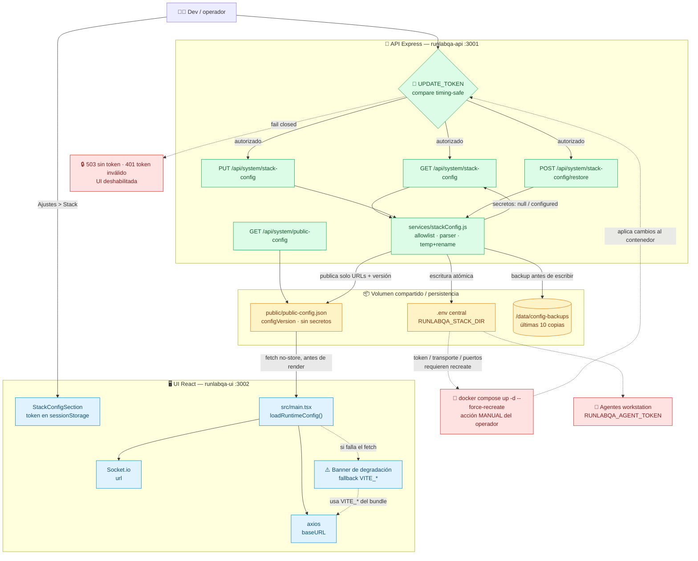
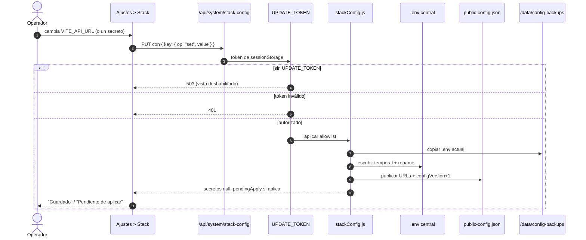
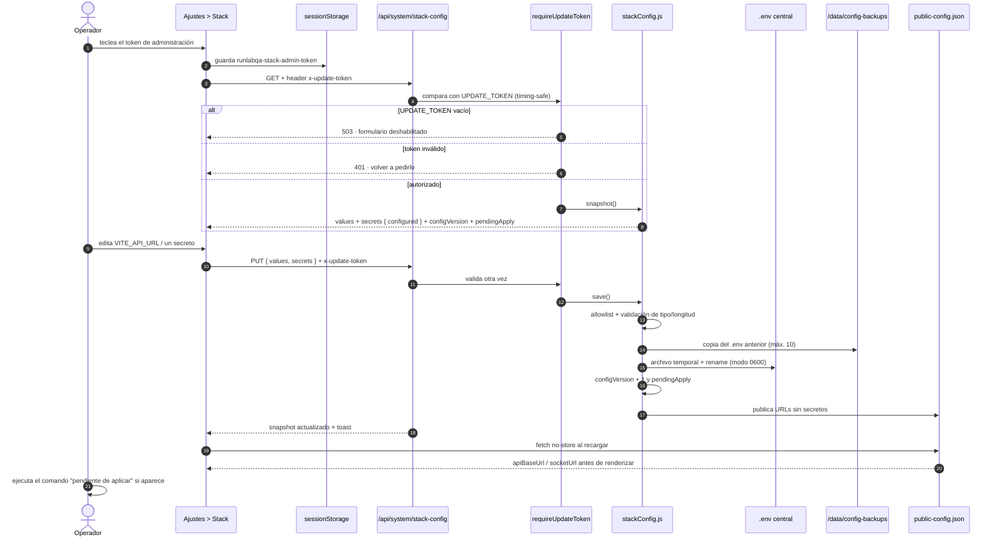

# 🐳 Onboarding Docker — RunLab Agrimpex (QA Dashboard)

> Guía para levantar el stack completo (API + UI) en Docker, entender el flujo
> de construcción de imágenes y resolver los problemas conocidos.
> Sigue el patrón de `DeviceActivityMonitor` (rama `feat/docker-onboarding`),
> adaptado a Express + Socket.io + Playwright.
>
> 📘 Referencia completa del stack (variables, montajes, migración y
> funcionamiento de los `.env`): [RunLab Agrimpex — Orquestación Docker](<../RunLab Agrimpex — Orquestación Docker.md>).

---

## Índice

1. [Arquitectura en Docker](#1-arquitectura-en-docker)
2. [Imágenes a descargar](#2-imágenes-a-descargar)
3. [Prerrequisitos](#3-prerrequisitos)
4. [Inicio rápido](#4-inicio-rápido)
5. [Verificación](#5-verificación)
6. [Configuración](#6-configuración)
7. [Flujo de construcción de imágenes](#7-flujo-de-construcción-de-imágenes)
8. [Comandos de referencia](#8-comandos-de-referencia)
9. [Troubleshooting](#9-troubleshooting)
10. [Mapa de archivos Docker](#10-mapa-de-archivos-docker)
11. [Notas para producción / limitaciones](#11-notas-para-producción--limitaciones)
12. [FAQ](#12-faq)

---

## 1. Arquitectura en Docker

```text
Navegador
   │  http://localhost:3002            (UI)
   │  http://localhost:3001/api        (REST)
   │  ws://localhost:3001/socket.io    (eventos en vivo)
   ▼
┌───────────────────────┐        ┌──────────────────────────────┐
│ runlabqa-ui  :3002      │        │ runlabqa-api  :3001            │
│ node:22-alpine        │        │ node:22-alpine               │
│ serve -s dist         │        │ (base opcional: Playwright)  │
│ (Dockerfile.npm)      │        │ (Dockerfile)                 │
└───────────────────────┘        └──────────────┬───────────────┘
                                                 │ volumen runlabqa-data -> /data
                                                 │ perfiles/, reports/, caches
                                                 ▼
                                    Kit Playwright (montar como volumen)
                                    AUT en el host (host.docker.internal)
```

| Servicio | Puerto host | Puerto contenedor | Imagen | Dockerfile canónico |
|---|---|---|---|---|
| API (Express + Socket.io) | `3001` | `3001` | `runlabqa-agrimpex-api` | `../runlab-agrimpex-api/Dockerfile` |
| UI (React + Vite) | `3002` | `3000` | `runlabqa-agrimpex-ui` | `Dockerfile.npm` |

> ⚠️ El puerto `3000` ya está ocupado por `dam-frontend` del stack de
> referencia (DAM). Por eso la UI de este stack se publica en `3002` y el
> contenedor sigue escuchando en `3000` internamente. Si detienes DAM, puedes
> usar `UI_PORT=3000` en `.env`.

> La red `runlabqa-network` existe para futuros proxies inversos. Hoy el
> navegador llama directamente a la API (CORS abierto), igual que en DAM.

---

## 2. Imágenes a descargar

**No hace falta descargar nada nuevo para levantar el stack**: ambas imágenes
base usan `node:22-alpine`, que ya está en caché en este equipo.

```bash
docker images node:22-alpine   # ya presente
```

### ¿Para qué sirve entonces `mcr.microsoft.com/playwright:v1.62.1-noble`?

No es la imagen de la API ni de la UI. Es una **base opcional** para la API
cuando quieras **ejecutar tests Playwright dentro del contenedor**: trae
Node 24, git, los navegadores y las librerías del sistema ya instaladas, con
la versión 1.62.1 que usa el kit (`playwright-kit-profesional`). Con
`node:22-alpine` el dashboard (REST + Socket.io) funciona normalmente, pero
los runs de Playwright necesitarán navegadores; en ese caso reconstruye con:

```bash
docker compose build runlabqa-api \
  --build-arg API_BASE_IMAGE=mcr.microsoft.com/playwright:v1.62.1-noble
```

o añade `API_BASE_IMAGE=...` a `.env`. Recién ahí sí hay que descargar esa
imagen. Si se actualiza `@playwright/test` en el kit, actualiza también el tag.

| Modo | Base | ¿Descarga? | Playwright dentro del contenedor |
|---|---|---|---|
| Por defecto | `node:22-alpine` | No | No (usar navegadores del host/grid remoto) |
| Opcional | `mcr.microsoft.com/playwright:v1.62.1-noble` | Sí | Sí |

> El CLI de `docker` **no** se instala en la imagen para no exigir otra
> descarga. Si necesitas el módulo `/api/docker`, monta el binario del host
> (ver §6.3).

---

## 3. Prerrequisitos

| Herramienta | Versión | Comando |
|---|---|---|
| Docker Engine | 24+ (probado con 29.7.1) | `docker --version` |
| Docker Compose plugin | v2+ | `docker compose version` |
| RAM libre | ≥ 4 GB | El build de UI + npm de la API requieren memoria |
| Disco | ≥ 1 GB libres | `node:22-alpine` + capas de build + `node_modules` (si activas Playwright, ≈ 1.7 GB extra) |

Red corporativa con proxy:

* Para que Docker descargue imágenes, configurar `registry-mirrors` en
  `/etc/docker/daemon.json` (ver guía de DAM) y `systemctl restart docker`.
* Para `npm install` dentro del build, descomenta `HTTP_PROXY`/`HTTPS_PROXY`
  en `.env`. El Dockerfile los pasa como `ARG`/`ENV`; los `.npmrc` de ambos
  repos incluyen timeouts y retries.

---

## 4. Inicio rápido

```bash
cd /home/potlitel/Trabajo/EICMA/Agrimpex/qa-dashboard/runlab-agrimpex-ui

# 1) Detén los servicios en host si están corriendo (start-dev.sh / npm run dev)
# 2) Configura el entorno
cp .env.example.stack .env

# 3) Construye y levanta todo
docker compose up -d --build
```

Primera vez: varios minutos (`npm ci` en ambos repos). Builds posteriores
usan caché. La imagen base por defecto (`node:22-alpine`) ya está en caché.

> Si vienen de `start-dev.sh`, los puertos 3001 (API) y 5173 (UI) quedarán
> liberados al detenerlo. **No** detengas el stack DAM para usar este: sus
> contenedores `dam-frontend`/`dam-api` ocupan 3000 y 8081, que no se usan aquí.
> Esta UI se publica en **3002**.

---

## 5. Verificación

Ejecuta SIEMPRE desde `runlab-agrimpex-ui/` (aquí está el `docker-compose.yml`).
Si `docker compose ps` sale vacío, el stack **no está levantado**: revisa el
directorio y que las imágenes base ya estén disponibles. Además, la UI
tiene `depends_on` con `condition: service_healthy`, así que si la API no
arranca, Compose tampoco publicará la UI.

```bash
docker compose ps                          # debe mostrar runlabqa-api y runlabqa-ui
curl -i http://localhost:3001/api/openapi.json   # 200 (healthcheck de la API)
curl -i http://localhost:3001/api/profile-admin  # 200, los 5 perfiles previos
curl -i http://localhost:3002/                   # 200 (index.html de la SPA)
docker compose logs -f runlabqa-api
docker compose logs -f runlabqa-ui
```

En el navegador:

* UI: <http://localhost:3002>
* Swagger: <http://localhost:3001/api/docs/>

> Si `http://localhost:3000` te muestra otra aplicación, es `dam-frontend`
> del proyecto de referencia, **no** la UI de RunLab. No es un fallo de este stack.

Para comprobar el canal en vivo, abre la UI y mira la consola del navegador:
debe conectarse a `ws://localhost:3001/socket.io`. Si se construyó con la URL
por defecto, `VITE_API_URL`/`VITE_SOCKET_URL` quedaron horneados en el bundle.

---

## 6. Configuración

### 6.1 URLs del frontend (build-time)

Vite **hornea** `VITE_*` en el bundle durante `npm run build`. Por eso son
`build.args` del compose y no variables del contenedor en ejecución.

| Variable | Default | Regla |
|---|---|---|
| `VITE_API_URL` | `http://localhost:3001/api` | Debe ser alcanzable **desde el navegador**. |
| `VITE_SOCKET_URL` | `http://localhost:3001` | Origen de Socket.io. Si se omite, se deriva de `VITE_API_URL`; en dev (sin variable) se usa el mismo origen y el proxy de Vite. |

Servidor remoto:

```bash
# .env
VITE_API_URL=http://10.0.0.50:3001/api
VITE_SOCKET_URL=http://10.0.0.50:3001
docker compose up -d --build runlabqa-ui
```

La UI en `src/lib/socket.ts` deriva el origen del socket de `VITE_API_URL`,
así que en la mayoría de los casos basta con cambiar esa única variable.

### 6.2 Persistencia

`RUNLABQA_DATA_DIR=/data` usa dos mecanismos complementarios:

| Destino en el contenedor | Origen en el host | Qué guarda |
|---|---|---|
| `/data` | volumen nombrado `runlabqa-data` | Datos generales (p. ej. `/data/json-snapshots.json`) |
| `/data/profiles` | bind mount `../runlab-agrimpex-api/profiles` | `index.json`, configs, entornos, schedules, caché y reportes **previos a Docker** |

```text
/data/profiles/index.json
/data/profiles/<id>/config.json, entornos.json, features.json, schedules.json
/data/profiles/<id>/reports/  /data/profiles/<id>/data/
/data/json-snapshots.json
```

* El bind mount tiene prioridad sobre `/data/profiles` del volumen: los 5
  perfiles que ya existían en el repo (`perfil-1`, `perfil-qa-test-2`,
  `perfil-1-copia`, `alain`, `jorge`) son los que ve la API.
* Los avatares **no son ficheros**: `avatar: { style, seed }` vive dentro de
  cada entrada de `/data/profiles/index.json` (en el host,
  `../runlab-agrimpex-api/profiles/index.json`). La UI genera el SVG con
  DiceBear en memoria; no hay `avatar.svg`/PNG ni data URIs en disco, ni
  llamadas a un servicio externo. Si una entrada antigua no trae avatar, se
  expone `{ style: 'notionists', seed: <id> }` y se escribe en el índice en la
  siguiente mutación.
* `.dockerignore` sigue excluyendo `profiles/` de la **imagen**, pero ahora se
  monta explícitamente desde el host; no se pierde al reconstruir.
* `docker compose down` conserva todo. `docker compose down -v` borra el
  volumen `runlabqa-data`, **pero no borra los perfiles del host**.
* Las variables `RUNLABQA_PROFILES_DIR` y `PLAYWRIGHT_KIT_DIR` en `.env` permiten
  cambiar los orígenes sin editar el compose.

### 6.3 Módulos que dependen del host

El kit Playwright está montado de forma activa en la **misma ruta absoluta**
que tienen los perfiles guardados, así que no hay que tocar `projectPath`:

```yaml
# En docker-compose.yml (activo por defecto):
- ${PLAYWRIGHT_KIT_DIR:-/home/potlitel/Trabajo/EICMA/Agrimpex/playwright-kit-profesional}:${PLAYWRIGHT_KIT_DIR:-/home/potlitel/Trabajo/EICMA/Agrimpex/playwright-kit-profesional}
```

> El kit **no** se incluye en la imagen. Sus `node_modules` (Playwright,
> allure, etc.) deben existir en el host. El montaje es escribible porque las
> corridas generan `test-results/` y `playwright-report/` dentro del proyecto;
> si solo vas a recolectar (`--list`), puedes añadir `:ro`.

Para el módulo `/api/docker`, descomenta además:

```yaml
- /var/run/docker.sock:/var/run/docker.sock
- /usr/bin/docker:/usr/bin/docker:ro
```

AUT en `localhost` del host: el contenedor usa
`host.docker.internal` (definido con `extra_hosts: host-gateway`). Ajusta las
URLs del perfil a `http://host.docker.internal:5000` / `:8990`.

### 6.4 Variables del backend

| Variable | Default en Docker | Descripción |
|---|---|---|
| `PORT` | `3001` | HTTP + Socket.io |
| `RUNLABQA_DATA_DIR` | `/data` | Persistencia (volumen) |
| `RUNLABQA_NOVNC_HOST` | `host.docker.internal` | Proxy noVNC |
| `RUNLABQA_NOVNC_PORT` | `7900` | Proxy noVNC |
| `TZ` | `America/Argentina/Buenos_Aires` | Zona horaria de las calendarizaciones |
| `UPDATE_TOKEN` | *(vacío)* | Sin él, `/api/system/update` responde 503 |

---

## 7. Flujo de construcción de imágenes

```bash
# Manual (equivalente a lo que hace compose):

# API (contexto = ../runlab-agrimpex-api)
docker build \
  -f ../runlab-agrimpex-api/Dockerfile \
  -t runlabqa-agrimpex-api \
  --build-arg HTTP_PROXY=${HTTP_PROXY:-} \
  ../runlab-agrimpex-api

docker run -d --name runlabqa-api -p 3001:3001 \
  -v runlabqa-data:/data \
  --add-host=host.docker.internal:host-gateway \
  runlabqa-agrimpex-api

# UI (contexto = .)
docker build \
  -f Dockerfile.npm \
  -t runlabqa-agrimpex-ui \
  --build-arg VITE_API_URL=http://localhost:3001/api \
  --build-arg VITE_SOCKET_URL=http://localhost:3001 \
  .

docker run -d --name runlabqa-ui -p 3002:3000 runlabqa-agrimpex-ui
```

Reglas aprendidas del repo de referencia y aplicadas aquí:

1. **Todo el build dentro de Docker.** No ejecutar `npm install` en el host:
   evita `node_modules` con dueño root y native bindings mezclados.
2. **`.dockerignore` en cada contexto.** Excluye `node_modules`, `dist`,
   `.git`, secretos y datos runtime (`profiles/`, `reports/`).
3. **Multi-stage en la UI.** `npm ci` + `tsc -b && vite build` en la fase
   build; `serve -s dist` en la fase runner. Sin `NODE_ENV=production` en
   build (omite devDependencies y falla `tsc`).
4. **`npm ci` con lockfile.** Ambos repos tienen `package-lock.json`
   versionado; no usar `npm install` ni yarn.
5. **Sin IP de proxy quemada.** Se pasa como `--build-arg` / variable de `.env`.

---

## 8. Comandos de referencia

```bash
docker compose up -d --build          # construir y levantar
docker compose up -d --build runlabqa-ui # reconstruir solo la UI tras cambiar URLs
docker compose ps                     # estado
docker compose logs -f                # logs de todos
docker compose logs -f runlabqa-api     # logs de la API
docker compose restart runlabqa-api
docker compose down                   # detener (conserva runlabqa-data)
docker compose down -v                # detener y borrar runlabqa-data (no los perfiles del host)
docker compose exec runlabqa-api sh     # shell dentro de la API
docker compose exec runlabqa-api sh -c 'ls /data/profiles'  # perfiles montados
curl -fsS http://localhost:3001/api/profile-admin          # ver los 5 perfiles
```

---

## 9. Troubleshooting

| # | Síntoma | Causa | Solución |
|---|---|---|---|
| 1 | `Cannot find native binding @rolldown/...` o `tsc: not found` en la UI | `node_modules` del host copiado al contexto, o `NODE_ENV=production` en build | `.dockerignore` excluye `node_modules`; no definir `NODE_ENV` en la fase build |
| 2 | La UI carga pero `/api` da 404/ERR_CONNECTION_REFUSED | `VITE_API_URL` apunta a otro host/puerto o la API no arrancó | Revisar `docker compose ps`, `curl :3001/api/openapi.json`, reconstruir UI con la URL correcta |
| 3 | REST funciona pero no llegan eventos en vivo | Socket.io apuntaba al origen de la UI | Verificar `VITE_SOCKET_URL` en el bundle; `src/lib/socket.ts` deriva el origen de `VITE_API_URL` |
| 4 | `EADDRINUSE` en 3001/3002 | `start-dev.sh`, `npm run dev` u otros contenedores ocupan el puerto | Detenerlos o cambiar `API_PORT`/`UI_PORT` en `.env` |
| 4b | `http://localhost:3000` muestra otra app (DAM) | Es `dam-frontend`, del stack de referencia | Usar `http://localhost:3002` para esta UI; no hace falta detener DAM |
| 4c | `docker compose ps` sale vacío y la API no responde | El stack nunca se levantó (directorio equivocado o las imágenes base no están disponibles) | Ejecutar compose desde `runlab-agrimpex-ui/`, verificar `docker images node:22-alpine` y luego `up --build` |
| 5 | Error al colectar/ejecutar tests: `Executable doesn't exist at /root/.cache/ms-playwright/...` | Versión de `@playwright/test` distinta a la imagen | Alinear tag `v1.62.1-noble` con el kit (o actualizar ambos) |
| 6 | Chromium se queda sin memoria / crash | IPC pequeño | Añadir `ipc: host` al servicio `runlabqa-api` en compose |
| 7 | `/api/docker` dice que Docker no está disponible | No hay CLI/socket en el contenedor | Descomenta los dos montajes del §6.3 |
| 8 | El selector de archivos (`/api/config/browse`) no responde | Usa `zenity` y el contenedor es headless | Introducir la ruta manualmente desde la UI; limitación conocida |
| 9 | Scheduler dispara a otra hora | Zona horaria del contenedor | Ajustar `TZ` en `.env` y recrear: `docker compose up -d --force-recreate runlabqa-api` |
| 10 | `npm ci` falla por timeout en la red corporativa | Proxy/registry | Descomenta `HTTP_PROXY`/`HTTPS_PROXY` en `.env`; los `.npmrc` ya tienen retries |
| 11 | `EACCES` escribiendo `/data` | Volumen creado por otro uid | `docker compose exec -u root runlabqa-api chown -R 1000:1000 /data` |
| 12 | Imagen base no descarga | Registry bloqueado | Configurar `registry-mirrors` en `/etc/docker/daemon.json` y reiniciar Docker |

**Regla de oro:** ante un fallo de build revisa, en orden: (1) proxy/daemon,
(2) `.dockerignore`, (3) `node_modules` del host, (4) versiones pinadas
(Node 22 / Playwright 1.62.1).

---

## 10. Mapa de archivos Docker

### Canónicos (usar estos)

| Archivo | Propósito |
|---|---|
| `docker-compose.yml` | Única puerta de entrada del stack |
| `.env.example.stack` | Plantilla completa del stack (puertos, URLs, proxy) |
| `.env.example` | Plantilla `VITE_*` para el dev local de Vite |
| `start-dev.sh` | Arranque manual de API + UI en el host |
| `../runlab-agrimpex-api/Dockerfile` | Imagen de la API (base `node:22-alpine`; Playwright opcional) |
| `../runlab-agrimpex-api/.dockerignore` | Contexto limpio (sin perfiles/reportes) |
| `../runlab-agrimpex-api/.npmrc` | Registry + timeouts/retries |
| `Dockerfile.npm` | Multi-stage build + `serve` |
| `.dockerignore` | Excluye `node_modules` del host |
| `.npmrc` | Registry + timeouts/retries |
| `docs/ONBOARDING_DOCKER.md` | Esta guía |

### Experimentales / históricos (NO usar)

En este repo: `Dockerfile` (Node 18, insuficiente para Vite 7),
`Dockerfile.dev`, `Dockerfile.frontend.nginx`, `Dockerfile.node-serve`,
`Dockerfile.optimized`, `Dockerfile.production`, `Dockerfile.simple`,
`Dockerfile.with-proxy`. Son intentos previos; varios copian `yarn.lock` o
rutas de DAM que no existen aquí. Se conservan por trazabilidad.

---

## 11. Notas para producción / limitaciones

1. **No exponer sin reverse proxy.** Terminar TLS en nginx/traefik delante de
   ambos servicios y restringir CORS (hoy `origin: '*'`).
2. **`UPDATE_TOKEN`:** dejar vacío. Las actualizaciones de código se hacen
   reconstruyendo la imagen, no con `git pull` dentro del contenedor.
3. **Playwright con root vs pwuser:** el contenedor corre como uid 1000 (`node`
   en Alpine, `pwuser` en la imagen Playwright). Para
   testing de sitios trusted está bien; para crawling, seguir las
   recomendaciones de sandbox del image de Playwright.
4. **Tests que usan `localhost` del AUT:** necesitan `host.docker.internal`
   (o `network_mode: host` en Linux). Revisar `projectPath`/URLs por perfil.
5. **Headless:** los diálogos nativos (`zenity`) no funcionan.
6. **Backups:** respaldar el volumen `runlabqa-data` y la carpeta
   `../runlab-agrimpex-api/profiles` (perfiles + reportes).
7. **Escaneo de imágenes:** `docker scout cves runlabqa-agrimpex-api` antes de
   publicar.

---

## 12. FAQ

**¿El frontend y la API deben estar en la misma red Docker?**
Para el build no. En runtime el navegador llama directamente a la API con
`VITE_API_URL` / `VITE_SOCKET_URL`. La red compartida facilita un futuro
proxy inverso.

**¿Se pierden los perfiles al reconstruir?**
No: viven en `../runlab-agrimpex-api/profiles` (bind mount). `docker compose
down -v` solo borra el volumen `runlabqa-data`, no los perfiles del host.

**¿Puedo seguir usando `start-dev.sh`?**
Sí, para desarrollo en host. No lo ejecutes mientras el stack Docker esté
arriba: hay conflicto de puertos.

**¿Por qué Node 22 en ambos servicios?**
Ambos usan `node:22-alpine` por defecto (Vite 7 acepta 22.12+ y ya está en
caché). La API puede usar opcionalmente la imagen oficial de Playwright
(Node 24) con `API_BASE_IMAGE`; Express/Socket.io no tienen restricción de
versión.

---

*Documentado a partir del flujo real de construcción del stack DAM y de las
particularidades de RunLab Agrimpex. Ante dudas: `docker compose logs -f`.*

---

## 13. Guía express para nuevos desarrolladores (`central-env-editor`)

> 📌 **Esta sección es aditiva.** Lo anterior sigue vigente como contexto
> histórico y de referencia del stack. Donde más arriba se dice que cambiar
>`VITE_*` exige reconstruir, eso aplica al **fallback horneado**; la URL que
> realmente usa la UI se resuelve ahora en **runtime** desde
> `/public-config.json`. Nada de lo ya documentado se eliminó.

### 13.1 ¿Qué problema resuelve?

Antes, para cambiar la URL de la API había que editar `VITE_API_URL`,
reconstruir la imagen de la UI y redesplegar. Y el `.env` del stack se editaba
a mano en el servidor, sin trazabilidad.

Ahora:

1. La UI lee `/public-config.json` **antes de renderizar** (`cache: 'no-store'`).
2. La API publica ese archivo desde el **`.env` central** con un
   `configVersion` que aumenta en cada guardado.
3. Un administrador edita el `.env` desde **Ajustes > Stack**, protegido por
   `UPDATE_TOKEN`. Cambiar URLs **no requiere rebuild**.
4. Los secretos son **write-only**: nunca vuelven en la respuesta; solo se
   indica si están configurados.
5. Cada escritura deja una copia en `/data/config-backups` (últimas 10) y se
   puede restaurar desde la misma pantalla.

### 13.2 Mapa de archivos (para no perderse)

**Repo `runlab-agrimpex-ui` (frontend + compose)**

| Archivo | Para qué sirve |
|---|---|
| `src/main.tsx` | Carga la config pública antes de `root.render()`. |
| `src/lib/runtime-config.ts` | `loadRuntimeConfig()`: fetch + fallback + aviso. |
| `src/context/runtime-config-context.tsx` | Provider, hook y banner de degradación. |
| `src/lib/api.ts` / `src/lib/socket.ts` | Aplican `apiBaseUrl` / `socketUrl` antes de crear los clientes. |
| `src/features/settings/use-stack-config-settings.ts` | Queries/mutations y token en `sessionStorage`. |
| `src/features/settings/components/stack-config-section.tsx` | Pantalla **Ajustes > Stack**. |
| `public/public-config.json` | Archivo shared servido por la UI en `/public-config.json`. |
| `docker-compose.yml` | Montajes `/stack-env` y del JSON público. |
| `.env.example.stack` | Plantilla con `UPDATE_TOKEN`, URLs y rutas del stack. |

**Repo `runlab-agrimpex-api` (backend)**

| Archivo | Para qué sirve |
|---|---|
| `services/stackConfig.js` | Allowlist, parser que conserva comentarios, temp + `rename`, backups y publicación. |
| `routes/stackConfig.js` | Endpoints y gate por `UPDATE_TOKEN`. |
| `server.js` | Monta el router y publica la config inicial al arrancar. |
| `services/stackConfig.test.js`, `routes/stackConfig.test.js` | Tests del módulo y de los endpoints. |

> ⚠️ Este `.env` central **no es** el `.env` del proyecto Playwright que se
> edita en Ajustes > Proyecto (`envPath`), ni el de cada perfil. Son tres
> cosas distintas.

### 13.3 Diagrama integral



**Cómo leerlo:** el camino de arriba hacia abajo es el guardado; el camino de
`public-config.json` hacia la UI es el arranque. El bloque rojo es lo que
**no** hace la aplicación por vos: recrear contenedores.

### 13.4 Secuencia de un guardado



### 13.5 Primer arranque en 5 minutos

```bash
cd /home/potlitel/Trabajo/EICMA/Agrimpex/qa-dashboard/runlab-agrimpex-ui
cp .env.example.stack .env          # si aún no existe
docker compose up -d --build --force-recreate
docker compose ps                    # api healthy + ui Up
curl -fsS http://localhost:3001/api/health
curl -fsS http://localhost:3002/public-config.json
```

Abrí <http://localhost:3002>, entrá a **Ajustes > Stack** y fijate:

- Si el formulario aparece deshabilitado con `503`, definí `UPDATE_TOKEN` en
  `.env` y recreá la API:
  `docker compose up -d --force-recreate runlabqa-api`.
- Si la UI muestra el aviso de degradación, revisá el montaje de
  `public/public-config.json` y los logs de la API.

### 13.6 Receta: cambiar el hostname sin rebuild

1. Poné `UPDATE_TOKEN=<token>` en el `.env` del stack y recreá la API.
2. En **Ajustes > Stack**, cargá ese token y editá `VITE_API_URL` /
   `VITE_SOCKET_URL` con el hostname real.
3. Guardá → `configVersion` aumenta y `/public-config.json` se actualiza.
4. Recargá el navegador. **No** corras `docker compose up -d --build runlabqa-ui`.

Para un secreto (p. ej. `RUNLABQA_AGENT_TOKEN`): elegí **Establecer**,
**Conservar** o **Borrar**. El campo siempre se muestra vacío/mascarado: si
querés conservarlo, dejalo en *Conservar*.

Si el cambio fue de `UPDATE_TOKEN`, `RUNLABQA_DOCKER_TRANSPORT`, puertos o
rutas, la vista muestra **«Pendiente de aplicar»** con el comando exacto
(por ejemplo `docker compose up -d --force-recreate runlabqa-api`). La app
**nunca ejecuta Docker**: lo ejecutás vos desde el repo donde está el compose.

### 13.7 Contrato rápido de endpoints

| Método | Ruta | Respuesta clave |
|---|---|---|
| `GET` | `/api/system/stack-config` | Valores allowlisteados; secretos `null` + `secrets: { KEY: { configured } }`. |
| `PUT` | `/api/system/stack-config` | `{ values: { KEY: { op: "keep"|"set"|"clear", value? } } }` → nuevo `configVersion` y `pendingApply`. |
| `POST` | `/api/system/stack-config/restore` | Restaura el backup más reciente; `404` si no hay copia. |
| `GET` | `/api/system/public-config` | Solo URLs y `configVersion`. Sin secretos. |

El gate devuelve `503` si `UPDATE_TOKEN` no está configurado y `401` si el
token enviado no coincide. El token se guarda solo en `sessionStorage`: al
cerrar la pestaña hay que volver a teclearlo.

### 13.8 Reglas de oro y errores típicos

| Síntoma | Causa probable | Acción |
|---|---|---|
| `503` en Ajustes > Stack | falta `UPDATE_TOKEN` | Definirlo en `.env` y recrear la API. |
| `401` | token mal copiado | Volver a cargarlo en el formulario. |
| Banner de degradación | `/public-config.json` no responde | Revisar montaje y logs; se usan las `VITE_*` del bundle. |
| «Pendiente de aplicar» sigue ahí | no se recreó el contenedor | Ejecutar el comando que muestra la UI. |
| No aparece un secreto | es write-only, por diseño | Mirar `configured: true/false`, nunca el valor. |
| `configVersion` no cambia | guardado rechazado o sin permisos | Revisar `docker compose logs runlabqa-api` y permisos de `/stack-env`. |

### 13.9 Quality gates (antes de pedir review)

```bash
# UI
npm run lint && npx tsc -b && npm test -- --run && npm run build

# API (desde ../runlab-agrimpex-api)
npm test
```

Tras un cambio de código (no solo de `.env`), reconstruí y recreá:

```bash
docker compose up -d --build --force-recreate runlabqa-api runlabqa-ui
docker compose ps
```

`docker compose restart` **no** incorpora un bundle nuevo: reutiliza la imagen
ya construida.

### 13.10 ¿Por dónde sigo?

- Configuración general del stack: [§6](#6-configuración) y
  [§7](#7-flujo-de-construcción-de-imágenes).
- Arquitectura completa de agentes: `../README.md` →
  [Arquitectura distribuida del módulo Docker](../README.md#arquitectura-distribuida-del-módulo-docker).
- Especificación formal del cambio:
  `openspec/changes/central-env-editor/specs/central-stack-config/spec.md`.
- Diseño y decisiones: `openspec/changes/central-env-editor/design.md`.

---

## 14. Flujo integral del token de administración y del `.env` central

> 📌 Esta sección también es **aditiva**: complementa la §13 y no reemplaza
> ninguna de las secciones anteriores. Se enfoca en la pregunta operativa
> concreta: *¿qué hace el “Token de administración” y cómo se edita el `.env`
> central de punta a punta?*

### 14.1 ¿Qué es el “Token de administración”?

Es el valor de `UPDATE_TOKEN` definido en el entorno de la **API**. No es un
usuario, no es una sesión de login y no es el token de los agentes
(`RUNLABQA_AGENT_TOKEN`). Es una credencial compartida de administración que
reutiliza exactamente el mismo gate que `/api/system/update`.

| Aspecto | Detalle |
|---|---|
| Dónde se define | En el `.env` del stack (el que está junto a `docker-compose.yml`). Compose lo inyecta en el contenedor como `UPDATE_TOKEN`. |
| Dónde se guarda en el navegador | En `sessionStorage`, clave `runlabqa-stack-admin-token`. También vive en memoria React mientras la pestaña esté abierta. |
| Cómo viaja | En el header HTTP **`x-update-token`** de `GET /api/system/stack-config`, `PUT /api/system/stack-config` y `POST /api/system/stack-config/restore`. |
| Qué NO hace | No autentica usuarios, no autoriza workstations, no reemplaza a `RUNLABQA_AGENT_TOKEN` y no se guarda en el `.env` ni en el servidor al teclearlo. |
| Cuándo se pierde | Al cerrar la pestaña del navegador (sessionStorage es por pestaña). Otra pestaña debe volver a teclearlo. |
| Excepción deliberada | `GET /api/system/public-config` **no** pide token: la UI lo necesita antes de saber dónde está la API. Solo expone URLs y `configVersion`. |

> ⚠️ **Huevo y gallina:** si `UPDATE_TOKEN` no está definido, la API responde
> `503` y **no hay forma de activar el gate desde la UI**. Hay que escribirlo
> en el `.env` del stack desde el servidor y recrear la API:
>
> ```bash
> echo 'UPDATE_TOKEN=<token-largo-y-aleatorio>' >> .env
> docker compose up -d --force-recreate runlabqa-api
> ```
>
> Un `docker compose restart` no alcanza: el contenedor conservaría el valor
> de entorno con el que fue creado.

### 14.2 Cómo decide la API si el token es válido

`requireUpdateToken` en `routes/stackConfig.js` hace tres cosas, en este orden:

1. Si `process.env.UPDATE_TOKEN` está vacío → **503** con `disabled: true`. No
   se revela ningún valor de configuración (fail closed).
2. Si el header `x-update-token` no coincide → **401**.
3. Si coincide → pasa al handler. La comparación usa
   `crypto.timingSafeEqual` después de chequear longitudes, para no filtrar
   el token por timing.

En la UI, `useStackConfigSettings` traduce eso en:

- `disabled: true` con `503` → formulario deshabilitado, sin campos.
- `needsToken: true` con `401` → pedir el token de nuevo.
- Con `200` → muestra los valores permitidos.

### 14.3 Secuencia completa (token → lectura → escritura → runtime)



### 14.4 Paso a paso para editar el `.env` central

1. **Sembrar el gate (una vez).** Confirmar que `UPDATE_TOKEN` existe en el
   `.env` del stack y recrear la API (ver §14.1).
2. **Abrir la vista.** <http://localhost:3002> → **Ajustes > Stack**. Si el
   formulario está deshabilitado, el token no fue sembrado o la API no se
   recreó.
3. **Conectarse.** Teclear el token en *Token de administración*. El hook lo
   guarda en `sessionStorage` y dispara un `GET` con el header
   `x-update-token`. El token se usa en memoria; no se escribe en el `.env`.
4. **Leer el snapshot.** La tabla muestra solo las claves permitidas. Los
   secretos aparecen como `null` y se resume su estado con
   `secrets: { KEY: { configured: true|false } }`.
5. **Editar.**
   - Variables normales: se validan según su tipo (`url`, `port`, `path`,
     `host`, `transport`, `text`); máximo 512 caracteres y sin saltos de línea.
   - Secretos: elegir **Conservar** (`keep`), **Establecer** (`set`, con valor
     nuevo) o **Borrar** (`clear`). `keep` no toca el archivo; `clear` escribe
     la clave vacía; `set` exige un valor no vacío válido.
6. **Guardar.** `PUT` con `{ values, secrets }`. La API: valida la allowlist,
   hace backup, reescribe el `.env` conservando comentarios y líneas no
   administrables, incrementa `configVersion`, calcula `pendingApply` y
   publica `public-config.json`.
7. **Aplicar en runtime.** Recargar la UI: `src/main.tsx` lee
   `/public-config.json` con `cache: 'no-store'` **antes** de crear axios y el
   socket. Un cambio de `VITE_API_URL`/`VITE_SOCKET_URL` no necesita rebuild.
8. **Aplicar lo que no es runtime.** Si aparece *«Pendiente de aplicar»*,
   ejecutar manualmente el comando mostrado (p. ej.
   `docker compose up -d --force-recreate runlabqa-api`). Aplica a
   `UPDATE_TOKEN`, `RUNLABQA_AGENT_TOKEN`, transporte, puertos, rutas,
   `TZ` y `noVNC`.
9. **Si cambiaste `UPDATE_TOKEN`**, tu token actual deja de servir después del
   recreate: volver a teclear el nuevo valor en el formulario.

### 14.5 Restauración

El botón **Restaurar** pide confirmación y envía `POST
/api/system/stack-config/restore` con el mismo header. La API toma el backup
más reciente de `/data/config-backups` (`stack-<timestamp>.env`), calcula qué
claves permitidas difieren y hace un *commit* normal: nuevo backup,
`configVersion + 1`, `pendingApply` y publicación del JSON público. Si no hay
copia, responde `404`.

> Restaurar **no borra** el historial: agrega otra copia y otra versión. El
> límite es de 10 backups; los más antiguos se eliminan automáticamente.

### 14.6 Modelo de seguridad y límites

- Los secretos son **write-only**: el `GET` nunca devuelve su valor; solo
  `configured`. Teclear un secreto no lo muestra en claro después de guardar.
- El token se guarda en `sessionStorage`, **no** en `localStorage`, **no** en
  la URL y **no** se persiste en el `.env` por parte de la UI.
- El header viaja en cada petición administrativa. En producción, terminar TLS
  en un reverse proxy: un token en claro por HTTP es legible por cualquiera
  en la red.
- Hoy no hay usuarios ni autorización por rol: quien conoce `UPDATE_TOKEN`
  puede administrar el stack. La capa de autenticación del dashboard es un
  trabajo futuro.
- El token vive en memoria del navegador mientras la pestaña está abierta:
  cualquier XSS podría leerlo. Por eso no se comparte con otros orígenes ni
  se guarda de forma persistente.

### 14.7 Errores específicos del flujo de token

| Síntoma en la UI | Código | Causa | Acción |
|---|---|---|---|
| Formulario gris, sin campos | `503` | `UPDATE_TOKEN` vacío en la API | Escribirlo en `.env` y `docker compose up -d --force-recreate runlabqa-api`. |
| «Token de administración inválido» | `401` | Valor mal copiado o cambiado | Volver a teclearlo; si se cambió en la UI, usar el nuevo. |
| Guardó pero no cambia la UI | — | Falta recargar para leer el JSON público | Recargar; verificar `/public-config.json` y `configVersion`. |
| Guardó pero sigue «Pendiente de aplicar» | — | Cambio de clave con `recreate` | Ejecutar el comando que muestra la tarjeta. |
| No aparece el secreto | — | Write-only por diseño | Confiar en `Configurado: sí/no`. |
| `404` al restaurar | `404` | No hay backups aún | Guardar al menos una vez; revisar `/data/config-backups`. |

---

## 15. Modelo de seguridad del “Token de administración” (PAT-like, no login)

> 📌 Esta sección también es **aditiva**. Profundiza el §14 sin reemplazarlo:
> pasa de *cómo usar* el token a *qué es* y *qué riesgos* introduce.

### 15.1 La diferencia conceptual clave

Lo que tenemos acá **no es un login**, es un **shared admin secret** —también
llamado *capability token* o API key estática.

> Un password autentica **a una persona** (usuario + credencial verificada
> contra un hash). Acá no hay persona: **quien tiene la cadena, tiene el
> permiso**. Es como una llave física, no como un DNI.

Por eso no se parece a lo que uno ve en sistemas con IAM maduro, y sí se
parece a los webhooks de GitHub, al `UPDATE_TOKEN` de este propio repo, a los
admin tokens de Grafana o al `X-API-Key` de muchas herramientas internas.

La analogía más precisa es un **PAT sin persona detrás**:

| GitHub PAT | Nuestro `UPDATE_TOKEN` |
|---|---|
| Está atado a un usuario (*personal*) | Es **compartido**: no hay dueño ni atribución |
| Tiene scopes, expiración, revocación y auditoría | No tiene nada de eso: es todo o nada, sin vencimiento |
| GitHub guarda un hash y lo muestra solo al crearlo | Está en **claro** en `.env` porque la API debe compararlo |

La allowlist de claves sería un pariente lejano de los *scopes*, pero es
**global**: no distingue operadores porque no hay operadores.

### 15.2 Cómo funciona en nuestra implementación

- El valor vive en `UPDATE_TOKEN` en el `.env` del stack.
- La API lo lee al arrancar (`process.env.UPDATE_TOKEN`).
- Cada petición administrativa manda el header `x-update-token`.
- El servidor compara con `crypto.timingSafeEqual` (longitud + comparación de
  tiempo constante).
- Sin token configurado → **503** (fail closed). Con token incorrecto →
  **401**. Correcto → pasa.
- El navegador lo guarda en `sessionStorage` de esa pestaña, **no** en
  `localStorage`, **no** en la URL y **no** en cookie.

Es deliberadamente chico y tonto. Y ahí están sus virtudes y sus pecados.

### 15.3 Ventajas

| Ventaja | Por qué importa acá |
|---|---|
| **Cero infraestructura** | No hay DB de usuarios, no hay JWT, no hay OAuth, no hay sesiones. Para una herramienta QA interna es oro. |
| **Fail closed** | Si no hay token, la API no devuelve ni un solo valor de configuración. No hay “modo lectura pública” accidental. |
| **No es cookie** | Como va en un header explícito, no hay CSRF clásico: el navegador no lo adjunta automáticamente a cualquier request. |
| **Comparación timing-safe** | Evita filtrar el secreto por tiempo de respuesta. Es un detalle pequeño pero profesional. |
| **Separación de dominios** | `UPDATE_TOKEN` (admin del stack) ≠ `RUNLABQA_AGENT_TOKEN` (agentes). Un agente comprometido no administra el stack. |
| **Allowlist + write-only** | Aunque tengas el token, solo podés tocar las claves permitidas y los secretos nunca se leen de vuelta. El daño está acotado. |
| **Rotación simple** | Cambiás el valor, recreás la API, listo. No hay que migrar usuarios ni revocar sesiones. |
| **Ephemeral en el browser** | `sessionStorage` muere al cerrar la pestaña: reduce la ventana de exposición frente a `localStorage`. |

### 15.4 Desventajas e inseguridades (la parte incómoda)

1. **No sabés quién lo hizo.** No hay identidad, no hay auditoría de actor. Si
   tres personas comparten el token, un cambio queda registrado como “alguien
   con la llave”. Tenés `configVersion` y backups con timestamp, pero no
   “Ana cambió el token a las 14:32”.

2. **Es un secreto estático y de larga duración.** No expira, no tiene MFA, no
   se revoca por usuario. Si se filtra, sigue sirviendo hasta que lo rotes. Y
   acá hay un detalle importante: **los backups copian el `.env` completo**,
   o sea que `/data/config-backups/stack-*.env` también contiene
   `UPDATE_TOKEN` y `RUNLABQA_AGENT_TOKEN` en claro. Ese directorio es tan
   sensible como el `.env` original.

3. **Es *bearer*: posesión = autorización.** Cualquier script que pueda leer
   `sessionStorage` de tu origin (XSS, extensión maliciosa, DevTools en una
   máquina compartida) obtiene el token. `sessionStorage` reduce la
   persistencia, pero **no protege contra XSS**: cualquier JS de tu propia
   app puede leerlo.

4. **Viaja en claro si no hay TLS.** El header `x-update-token` es texto. En
   `http://localhost` está bien; en producción, sin reverse proxy con HTTPS,
   cualquiera en la red lo ve. Y el CORS abierto (`origin: '*'`) significa que
   otro sitio podría enviar el header **si ya tiene el token**.

5. **No hay rate limiting.** `timingSafeEqual` evita timing attacks, pero no
   evita fuerza bruta. Con 48 hex (192 bits) como el valor sembrado para la
   prueba, eso es irrelevante; si alguien pone `UPDATE_TOKEN=admin123`, ya no
   tanto.

6. **Divergencia entre archivo y contenedor.** La UI escribe el `.env`, pero
   el contenedor ya arrancó con el valor viejo. Por eso `UPDATE_TOKEN`
   cambiado desde la UI solo surte efecto después del `force-recreate`. Es el
   “huevo y gallina” del §14: no podés activar el gate desde la UI si está en
   `503`.

7. **Write-only también tiene coste.** No poder releer un secreto es bueno
   para seguridad, pero malo para operación: si tecleás mal
   `RUNLABQA_AGENT_TOKEN`, no lo ves; solo podés restaurar. Es un trade-off
   consciente.

### 15.5 Escenarios donde este patrón encaja

- Herramientas internas detrás de VPN/LAN, con pocos operadores.
- Endpoints de bootstrap/setup que necesitás antes de tener usuarios.
- Deploy hooks (`/api/system/update`), webhooks, admin de un stack local.
- CI que necesita “abrir” una configuración sin involucrar IAM corporativo.
- Como mecanismo **break-glass** complementario, no reemplazo, de un auth real.

### 15.6 Escenarios donde no alcanza

- Internet público, multi-usuario o compliance (SOX/ISO/GDPR).
- Necesitás no-repudio (“quién cambió qué”).
- Necesitás expiración, MFA, scopes o revocación individual.
- Manejás secretos de producción de alto valor y querés defensa en profundidad
  real.

### 15.7 Comparación con otros mecanismos

| Mecanismo | Qué ganás | Qué perdés |
|---|---|---|
| **Este token compartido** | Simplicidad extrema | Identidad, expiración, auditoría |
| **Basic Auth** | Estándar, soporte universal | Se cachea, se manda automáticamente, más CSRF |
| **JWT firmado de corta duración** | Expira, lleva claims/scopes | Necesitás clave, reloj sincronizado, refresh |
| **OAuth/OIDC** | Usuarios, MFA, revocación, auditoría | Mucha más superficie y operación |
| **mTLS** | Identidad de máquina, no hay bearer en el browser | Certificados, PKI, complejidad |
| **HMAC con timestamp/nonce** | El secreto no viaja, anti-replay | Cliente más complejo, sincronía de reloj |
| **IP allowlist** | Sin secreto que robar | Frágil con IPs dinámicas/NAT |

### 15.8 Recomendación para este proyecto

Para el escenario de uso de RunLab (QA interno, stack local, pocos
operadores), el mecanismo está **bien dimensionado**. Yo solo agregaría, en
este orden:

1. **TLS/reverse proxy + VPN** antes de exponer el puerto `3001`.
2. **Permisos estrictos** en `.env` y en `/data/config-backups` (son la misma
   sensibilidad).
3. **Rate limiting** en respuestas `401` del gate.
4. **Log de auditoría sin valores**: `configVersion`, claves tocadas,
   timestamp e IP; nunca el token ni secretos.
5. **Rotación periódica** del token, y rotarlo ya después de esta prueba.
6. Si aparece un escenario multi-usuario real: pasar a tokens por operador con
   expiración, o directo a OIDC. Mantener este como *break-glass*.

### 15.9 En resumen

> Es una **cerradura de llave compartida**. Excelente para el cuarto de
> herramientas del equipo; no es la cerradura del banco. Lo importante es
> saber que es **llave, no credencial de persona**: esa confusión es la que
> suele meter a uno en problemas.
